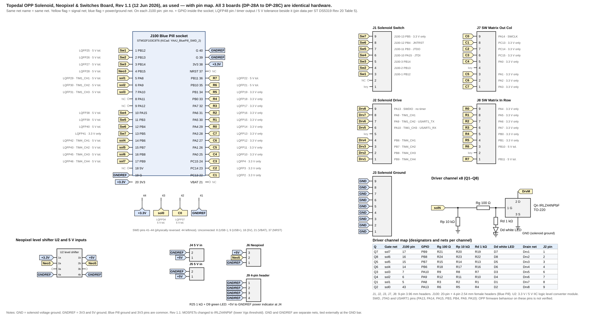

# DP-28 Topedal board schematic

**Revision:** 20261110-01 · **Date:** 2026-11-10

The 3 boards (DP-28A, DP-28B, DP-28C) are identical hardware: this one schematic and pin map applies to each. The pin map is carried on the drawing (GPIO, LQFP48 pin, timer output and 5 V tolerance on each J100 pin, with the J1/J2/J7/J8 connector pins); the Topedal Pin Map table below is the net-by-net list of the same data.

## Driver channel map

| Q | Gate net | J100 pin | GPIO | Rg 100 Ω | Rp 10 kΩ | Rd 1 kΩ | Dd white LED | Drain net | J2 pin |
|---|---|---|---|---|---|---|---|---|---|
| Q7 | sol7 | 17 | PB9 | R21 | R20 | R19 | D7 | Drv1 | 1 |
| Q8 | sol6 | 16 | PB8 | R24 | R23 | R22 | D8 | Drv2 | 2 |
| Q5 | sol5 | 15 | PB7 | R15 | R14 | R13 | D5 | Drv3 | 3 |
| Q6 | sol4 | 14 | PB6 | R18 | R17 | R16 | D6 | Drv4 | 4 |
| Q3 | sol3 | 7 | PA10 | R9 | R8 | R7 | D3 | Drv5 | 6 |
| Q4 | sol2 | 6 | PA9 | R12 | R11 | R10 | D4 | Drv6 | 7 |
| Q1 | sol1 | 5 | PA8 | R3 | R2 | R1 | D1 | Drv7 | 8 |
| Q2 | sol0 | 43 | PA13 | R6 | R5 | R4 | D2 | Drv8 | 9 |

## Parts table

| Ref | Part | Note |
|---|---|---|
| Q1–Q8 | IRLZ44NPbF, TO-220 | Rev 1.1 (was IRL540); sources on GND |
| Rg (R3, R6, R9, R12, R15, R18, R21, R24) | 100 Ω | Between gate net and MOSFET gate |
| Rp (R2, R5, R8, R11, R14, R17, R20, R23) | 10 kΩ | Gate net to GND, GPIO side of Rg |
| Rd (R1, R4, R7, R10, R13, R16, R19, R22) and Dd (D1–D8) | 1 kΩ + 3 mm white LED | Gate net to GND, GPIO side of Rg |
| R25, D9 | 1 kΩ, 3 mm green LED | +5 V to GNDREF power indicator at J4 |
| U2 | 3.3 V / 5 V IIC logic level converter module | Pinout must match the drawing |
| J100 | 20-pin and 4-pin 2.54 mm female headers (Blue Pill) | Pins 41–44 physically reversed |
| J1, J2, J3, J7, J8 | 9-pin 3.96 mm headers | Key/unused pins as drawn |
| J4, J5 / J6 / J9 | 2-pin / 3-pin / 4-pin | J9 4-pin is GNDREF only |

## Net table

| Net | Connections |
|---|---|
| GND | MOSFET sources, J3 pins 1–9, Rp/Rd return |
| GNDREF | J100 pins 19, 39, 40, 41; J4/J5/J6 ground pins; U2 4a/4b; J9; R25/D9 return |
| +3.3V | J100 pins 20, 38, 44; U2 1a |
| +5V | J4 pin 1, J5 pin 1, J6 pin 3, U2 1b, R25 |
| Unconnected | J100 pins 8, 9, 18, 21, 37; J1 pin 2; U2 3a/3b |
| GND–GNDREF | Separate nets on the board; tied externally (P-08) |

## Topedal Pin Map

| Net | Board pin | J100 pin | Blue Pill GPIO | LQFP48 pin | Timer output | 5 V tolerance | Note |
|---|---|---|---|---|---|---|---|
| Drv1 | J2-1 | 17 | PB9 | 46 | TIM4_CH4 | 5 V tol. | sol7 / Q7 |
| Drv2 | J2-2 | 16 | PB8 | 45 | TIM4_CH3 | 5 V tol. | sol6 / Q8 |
| Drv3 | J2-3 | 15 | PB7 | 43 | TIM4_CH2 | 5 V tol. | sol5 / Q5 |
| Drv4 | J2-4 | 14 | PB6 | 42 | TIM4_CH1 | 5 V tol. | sol4 / Q6 |
| Drv5 | J2-6 | 7 | PA10 | 31 | TIM1_CH3 | 5 V tol. | sol3 / Q3; USART1_RX pin |
| Drv6 | J2-7 | 6 | PA9 | 30 | TIM1_CH2 | 5 V tol. | sol2 / Q4; USART1_TX pin |
| Drv7 | J2-8 | 5 | PA8 | 29 | TIM1_CH1 | 5 V tol. | sol1 / Q1 |
| Drv8 | J2-9 | 43 | PA13 | 34 |   | 5 V tol. | sol0 / Q2; SWDIO pin |
| Sw1 | J1-3 | 1 | PB12 | 25 |   | 5 V tol. |   |
| Sw2 | J1-4 | 2 | PB13 | 26 |   | 5 V tol. |   |
| Sw3 | J1-5 | 3 | PB14 | 27 |   | 5 V tol. |   |
| Sw4 | J1-6 | 10 | PA15 | 38 |   | 5 V tol. | JTDI pin |
| Sw5 | J1-7 | 11 | PB3 | 39 |   | 5 V tol. | JTDO pin |
| Sw6 | J1-8 | 12 | PB4 | 40 |   | 5 V tol. | JNTRST pin |
| Sw7 | J1-9 | 13 | PB5 | 41 |   | 3.3 V only |   |
| Neo3 | level shifter 2a | 4 | PB15 | 28 |   | 5 V tol. | to Neo5 at J6-2 |
| C0 | J7-9 | 42 | PA14 | 37 |   | 5 V tol. | SWCLK pin |
| C1 | J7-8 | 22 | PC13 | 2 |   | 3.3 V only |   |
| C2 | J7-7 | 23 | PC14 | 3 |   | 3.3 V only |   |
| C3 | J7-6 | 24 | PC15 | 4 |   | 3.3 V only |   |
| C4 | J7-5 | 25 | PA0 | 10 |   | 3.3 V only |   |
| C5 | J7-3 | 26 | PA1 | 11 |   | 3.3 V only |   |
| C6 | J7-2 | 27 | PA2 | 12 |   | 3.3 V only |   |
| C7 | J7-1 | 28 | PA3 | 13 |   | 3.3 V only |   |
| R0 | J8-9 | 29 | PA4 | 14 |   | 3.3 V only |   |
| R1 | J8-8 | 30 | PA5 | 15 |   | 3.3 V only |   |
| R2 | J8-7 | 31 | PA6 | 16 |   | 3.3 V only |   |
| R3 | J8-6 | 32 | PA7 | 17 |   | 3.3 V only |   |
| R4 | J8-5 | 33 | PB0 | 18 |   | 3.3 V only |   |
| R5 | J8-4 | 34 | PB1 | 19 |   | 3.3 V only |   |
| R6 | J8-3 | 35 | PB10 | 21 |   | 5 V tol. |   |
| R7 | J8-1 | 36 | PB11 | 22 |   | 5 V tol. |   |

*Rev 1.1; verified against the V02 Gerber nets and the board photos. Data is carried on the drawing; this table is the net-by-net list of the same data.*

## Topedal Pin Map notes

| Item | Definition |
|---|---|
| Source | Topedal Rev 1.1 schematic and Blue Pill data; LQFP48 pins, timers and 5 V tolerance from ST DS5319 Rev 20 Table 5. Pin-to-GPIO mapping is the symbol pin order against the verified header order |
| Powered sensors on direct inputs | Direct inputs are Sw1–Sw7 and, by repurposing the matrix header, C0–C7 and R0–R7. Sw7 (PB5), C1–C7 (PC13–PC15, PA0–PA3) and R0–R5 (PA4–PA7, PB0, PB1) are 3.3 V only and are not 5 V tolerant |
| Debug and USART pins | Drv8 (PA13) and C0 (PA14) are the SWD pins; Sw4–Sw6 (PA15, PB3, PB4) are JTAG pins at reset; Drv5 and Drv6 (PA10, PA9) are USART1 pins. OPP firmware behaviour on these pins is not verified |
| Hold-PWM channels | Only Drv1–Drv7 have a timer output; Drv8 (PA13) has none |
| Unconnected | J100 pins 8, 9, 18, 21, 37 |

