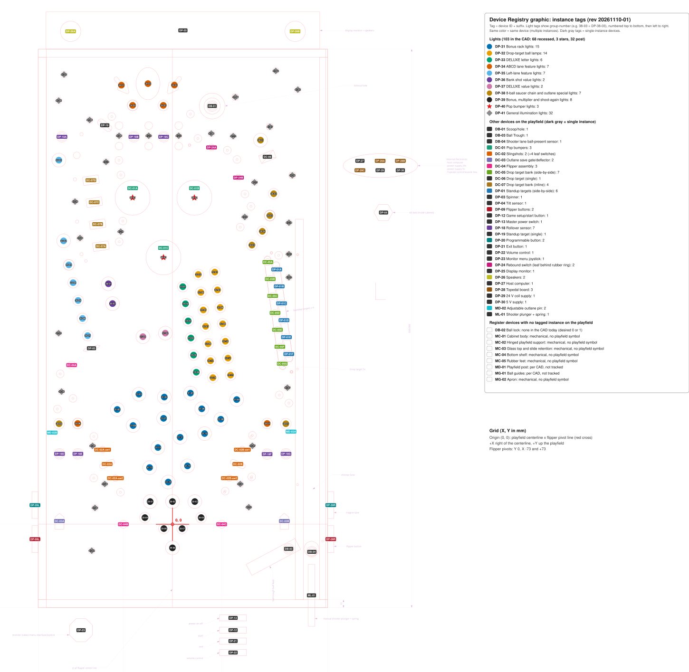

# Machine Master

**Revision:** 20261110-02 · **Date:** 2026-11-10

## System overview

### System

| Topic | Definition |
|---|---|
| Hybrid pinball | Typical pinball playing field used to accomplish game scenario objectives displayed real-time on monitor |
| Physical machine | Portable, tabletop cabinet containing typical pinball devices controlled using modern day electronics + monitor for real-time graphics |
| Game scenarios | Software defined theme packs played on generic playing field |

### Mechanical

| # | Item | Description |
|---|---|---|
| 1 | Cabinet | Baltic birch plywood construction |
| 2 | Materials | COTS materials and fasteners; 3D printed and laser cut custom parts |
| 3 | Access | Hinged playfield (service access); fixed bottom shelf panel; no legs — rubber pads only |

### Electrical

| # | Item | Description |
|---|---|---|
| 1 | Time-critical devices | All solenoid firing runs through the Topedal board's Blue Pill firmware (fire pulse, then PWM hold where used); no hardware autofire (safety). The switches for DC-01 Pop bumpers, DC-02 Slingshots and DC-04 Flipper Assembly are on the same Topedal board as their coils |
| 2 | Non-time-critical devices | Digital switches connected via Topedal board's onboard direct/matrix switch inputs |
| 3 | Rules engine & asset management | Computer supporting MPF + Godot Media Controller (GMC) running Mission Pinball Framework (MPF) — game logic, scoring, game scenarios; GMC for audio/video/monitor display |
| 4 | Comm bus | USB serial between host and Topedal board(s) |

### Software

| # | Item | Description |
|---|---|---|
| 1 | Firmware | Identical OPP firmware flashed to all Topedal boards (same STM32F103 processor as standard OPP), distinguished by board address; MPF config (not firmware) defines game scenario behavior |
| 2 | Game scenarios | A game scenario is defined by populating a Game Scenario Framework — requires no firmware changes |
| 3 | Playing field devices | <b>Primitive</b> — single physical switch/coil/sensor, no sub-components, assigned unique ID. <b>Composite</b> — 2 or more primitives combined to perform one coordinated physical action, e.g., button + coil + EOS sensor = flipper assembly. <b>Ball-state Device</b> — tracks ongoing ball location/count/presence as persistent state, e.g., scoop, ball lock, or trough |
| 4 | Game setup | Players select game preferences before starting a game. Setup parameters include standard parameters applicable to all scenarios + scenario-specific parameters |

## Requirements

### System-Level Requirements

| ID | Title | Definition | Category | Type |
|---|---|---|---|---|
| S-01 | Game play | Playing field ball action and control will be similar to a traditional, full sized pinball machine (1 1/16" dia balls, 40" x 20.5" playing field, 6.5-7 deg slope). Audio, graphics, and video are used to enhance the gaming experience including real-time game scenario progress | Functional | Mandatory |
| S-02 | Game scenarios | System supports user selectable game scenarios. Scenarios have unique themes that use the same generic playing field | Functional | Mandatory |
| S-03 | Game setup parameters | Game parameters will be selected by the player before each game is started. Example parameters include: game difficulty level, number of players, player names, scenario, scenario specific parameters | Functional | Mandatory |
| G-01 | Initialize game | Master power ON, monitor presents setup prompts which player selects | Functional | Mandatory |
| G-02 | Select scoring targets | Player uses onscreen game info to identify best scoring targets | Functional | Mandatory |
| G-03 | Shoot ball | Player launches ball onto playing field using shooter | Functional | Mandatory |
| G-04 | Playing field action | Player uses flippers and programmable buttons (DP-20 Programmable button) to keep ball in play and interact with the game to maximize score | Functional | Mandatory |
| G-05 | Repeat | Repeat steps G-02–G-04 until turn is over | Functional | Mandatory |
| C-01 | Physical | Portable system, played on tabletop, stored in typical household closet | Constraint | Mandatory |
| C-02 | Components | Use COTS parts and materials including modern electronics to replace traditional electro-mechanical, analog devices. Fab and assembly using standard workshop equipment plus 3D printer and 40W laser (24"x12" bed) | Constraint | Mandatory |
| C-03 | Safety | Electrical design will comply with industry-standard safety practices | Constraint | Mandatory |

### Software Requirements — Game Setup Parameters

| ID | Parameter | Scope | Setting | Default | Applies To | Comments |
|---|---|---|---|---|---|---|
| GP-01 | Number of players | Global | 1–4 | 1 | All | — |
| GP-02 | Player name/initials | Per-player | Free text | — | All | Data structure defined in Detailed Design |
| GP-03 | Per-player difficulty tier | Per-player | 1-Clueless 2-Beginner 3-Intermediate 4-Advanced 5-Champion | 3 | All | Data structure defined in Detailed Design |
| GP-04 | Balls per game | Global | 1–10 | 3 | All | — |
| GP-05 | Outlane save budget | Global | 0–5 | 3 | All | — |
| GP-06 | Outlane save time | Global | 0–15 seconds | 5 | All | — |
| GP-07 | Tilt warning count | Global | 0–5 | 3 | All | 0=Disabled |
| GP-08 | Tilt warning sensitivity | Global | 1-Very low 2-Low 3-Medium 4-High 5-Very high | 3 | All | Requires ADC test values |
| GP-09 | Game scenario selection | Global | List of installed scenario IDs | — | All | — |
| GP-10 | Outlane width | TBD | 1-Liberal 2-Normal 3-Difficult | 2 | All | Physical implementation: MD-02 Adjustable outlane pin. Scope TBD pending mechanism decision |

## System architecture

## Device Register

Every device, mechanical-only included. CAD controls counts. Instance coordinates are in the Instance table.

| ID | Device | Tier | Qty | Electrical? | CAD legend symbol |
|---|---|---|---|---|---|
| DB-01 | Scoop/hole | Ball-State Device | 1 | Y | kickout hole (with its inductive metal detector) |
| DB-02 | Ball lock | Ball-State Device | 0–1 (desired) | TBD | none |
| DB-03 | Ball Trough | Ball-State Device | 1 | Y | ball trough / ball feed (with its inductive metal detector) |
| DB-04 | Shooter lane ball-present sensor | Ball-State Device | 1 | Y | inductive metal detector (shooter lane) |
| DC-01 | Pop bumpers | Composite Mech | 3 | Y | pop bumper |
| DC-02 | Slingshots | Composite Mech | 2 | Y | sling shot (with 2 leaf switch symbols each) |
| DC-03 | Outlane save gate/deflector | Composite Mech | 2 | Y | ball save |
| DC-04 | Flipper assembly | Composite Mech | 3 | Y | Flipper |
| DC-05 | Drop target bank (side-by-side) | Composite Mech | 7 | Y | Drop target 7x |
| DC-06 | Drop target (single) | Composite Mech | 1 | Y | drop target 1-blade |
| DC-07 | Drop target bank (inline) | Composite Mech | 4 | Y | drop target 4-blade inline |
| DP-01 | Standup targets (side-by-side) | Primitive | 6 | Y | Standup targets x 6 |
| DP-03 | Spinner | Primitive | 1 | Y | spinner |
| DP-04 | Tilt sensor | Primitive | 1 | Y | tilt bob |
| DP-09 | Flipper buttons | Primitive | 2 | Y | flipper button |
| DP-12 | Game setup/start button | Primitive | 1 | Y | start |
| DP-13 | Master power switch | Primitive | 1 | Y | power on-off |
| DP-18 | Rollover sensor | Primitive | 7 | Y | inductive metal detector (the 7 on the playfield) |
| DP-19 | Standup target (single) | Primitive | 1 | Y | standup target 1-blade |
| DP-20 | Programmable button | Primitive | 2 | Y | magna-save |
| DP-21 | Exit button | Primitive | 1 | Y | exit |
| DP-22 | Volume control | Primitive | 1 | Y | volume control |
| DP-23 | Monitor menu joystick | Primitive | 1 | Y | monitor (video) menu interface/joystick |
| DP-24 | Rebound switch (leaf behind rubber ring) | Primitive | 2 | Y | leaf switch (the 2 near the pop bumpers) |
| DP-25 | Display monitor | System | 1 | Y | display monitor + speakers (box) |
| DP-26 | Speakers | System | 2 | Y | display monitor + speakers (2 circles) |
| DP-27 | Host computer | System | 1 | Y | Internal Electronics (host computer) |
| DP-28 | Topedal board | System | 3 | Y | Internal Electronics (Topedal control boards 3ea) |
| DP-29 | 24 V coil supply | System | 1 | Y | Internal Electronics (power supply 24v) |
| DP-30 | 5 V supply | System | 1 | Y | Internal Electronics (power supply 5v) |
| DP-31 | Bonus rack lights | Primitive | 15 | Y | lights |
| DP-32 | Drop-target ball lamps | Primitive | 14 | Y | pool ball light |
| DP-33 | DELUXE letter lights | Primitive | 6 | Y | light |
| DP-34 | ABCD lane feature lights | Primitive | 7 | Y | light |
| DP-35 | Left-lane feature lights | Primitive | 7 | Y | light |
| DP-36 | Bank shot value lights | Primitive | 2 | Y | light |
| DP-37 | DELUXE value lights | Primitive | 2 | Y | light |
| DP-38 | 8-ball saucer chain and outlane special lights | Primitive | 7 | Y | light |
| DP-39 | Bonus, multiplier and shoot-again lights | Primitive | 8 | Y | light |
| DP-40 | Pop bumper lights | Primitive | 3 | Y | star |
| DP-41 | General illumination lights | Primitive | 32 | Y | post light |
| MC-01 | Cabinet body | Mechanical | Per CAD | N | none |
| MC-02 | Hinged playfield support | Mechanical | Per CAD | N | none |
| MC-03 | Glass top and slide retention | Mechanical | Per CAD | N | none |
| MC-04 | Bottom shelf | Mechanical | Per CAD | N | none |
| MC-05 | Rubber feet | Mechanical | Per CAD | N | none |
| MD-01 | Playfield post | Mechanical | Per CAD (not tracked) | N | post tapered, post shaft |
| MD-02 | Adjustable outlane pin | Mechanical | 2 | N | adjustable outlane pin |
| MG-01 | Ball guides | Mechanical | Per CAD (not tracked) | N | ball guide plexiglass standoff |
| MG-02 | Apron | Mechanical | 1 | N | none |
| ML-01 | Shooter plunger + spring | Mechanical | 1 | N | manual shooter plunger + spring |

## Instance table

X and Y in mm from the grid origin (see Device Registry graphic). Right of the centerline and up the playfield are positive.

| Instance ID | Device ID | X mm | Y mm |
|---|---|---|---|
| DB-01 | DB-01 | 58.9 | 621.4 |
| DB-03 | DB-03 | 172.4 | -36.4 |
| DB-04 | DB-04 | 206.9 | -40.8 |
| DC-01A | DC-01 | -59.2 | 485.2 |
| DC-01B | DC-01 | 32.5 | 485.2 |
| DC-01C | DC-01 | -13.4 | 396.5 |
| DC-02A | DC-02 | -97.0 | 89.5 |
| DC-02A-sw1 | DC-02 | -103.8 | 110.9 |
| DC-02A-sw2 | DC-02 | -84.7 | 68.6 |
| DC-02B | DC-02 | 97.0 | 89.5 |
| DC-02B-sw1 | DC-02 | 103.7 | 110.9 |
| DC-02B-sw2 | DC-02 | 84.6 | 68.6 |
| DC-03A | DC-03 | -167.9 | 4.8 |
| DC-03B | DC-03 | 166.1 | 4.8 |
| DC-04A | DC-04 | -149.8 | 236.6 |
| DC-04B | DC-04 | -73.0 | 0.1 |
| DC-04C | DC-04 | 73.0 | 0.1 |
| DC-05A | DC-05 | 141.6 | 389.6 |
| DC-05B | DC-05 | 145.1 | 364.4 |
| DC-05C | DC-05 | 148.7 | 339.3 |
| DC-05D | DC-05 | 152.2 | 314.1 |
| DC-05E | DC-05 | 155.8 | 289.0 |
| DC-05F | DC-05 | 159.4 | 263.8 |
| DC-05G | DC-05 | 162.9 | 238.7 |
| DC-06 | DC-06 | 140.9 | 546.0 |
| DC-07A | DC-07 | -106.3 | 413.2 |
| DC-07B | DC-07 | -111.2 | 445.9 |
| DC-07C | DC-07 | -116.2 | 478.5 |
| DC-07D | DC-07 | -121.1 | 511.2 |
| DP-01A | DP-01 | 154.8 | 378.6 |
| DP-01B | DP-01 | 158.4 | 353.5 |
| DP-01C | DP-01 | 161.9 | 328.3 |
| DP-01D | DP-01 | 165.5 | 303.2 |
| DP-01E | DP-01 | 169.1 | 278.0 |
| DP-01F | DP-01 | 172.6 | 252.9 |
| DP-03 | DP-03 | -120.2 | 261.5 |
| DP-04 | DP-04 | 313.3 | 463.2 |
| DP-09L | DP-09 | -204.2 | -22.1 |
| DP-09R | DP-09 | 235.0 | -22.1 |
| DP-12 | DP-12 | 89.9 | -157.2 |
| DP-13 | DP-13 | 89.9 | -139.1 |
| DP-18A | DP-18 | -164.1 | 575.7 |
| DP-18B | DP-18 | -57.3 | 575.7 |
| DP-18C | DP-18 | -13.1 | 575.7 |
| DP-18D | DP-18 | -167.7 | 104.7 |
| DP-18E | DP-18 | -140.5 | 104.7 |
| DP-18F | DP-18 | 140.5 | 104.2 |
| DP-18G | DP-18 | 168.5 | 104.7 |
| DP-19 | DP-19 | -100.6 | 592.9 |
| DP-20L | DP-20 | -204.2 | 28.5 |
| DP-20R | DP-20 | 235.0 | 28.5 |
| DP-21 | DP-21 | 89.9 | -173.4 |
| DP-22 | DP-22 | 89.9 | -190.5 |
| DP-23 | DP-23 | -135.8 | -157.3 |
| DP-24A | DP-24 | 58.0 | 559.9 |
| DP-24B | DP-24 | 98.0 | 515.1 |
| DP-25 | DP-25 | 15.5 | 733.8 |
| DP-26A | DP-26 | -151.3 | 732.4 |
| DP-26B | DP-26 | 182.0 | 732.4 |
| DP-27 | DP-27 | 278.3 | 540.0 |
| DP-28A | DP-28 | 308.3 | 540.0 |
| DP-28B | DP-28 | 338.3 | 540.0 |
| DP-28C | DP-28 | 278.3 | 526.0 |
| DP-29 | DP-29 | 308.3 | 526.0 |
| DP-30 | DP-30 | 338.3 | 526.0 |
| DP-31-01 | DP-31 | -49.8 | 193.3 |
| DP-31-02 | DP-31 | -12.2 | 189.0 |
| DP-31-03 | DP-31 | 26.7 | 194.9 |
| DP-31-04 | DP-31 | 95.4 | 185.3 |
| DP-31-05 | DP-31 | -82.0 | 170.6 |
| DP-31-06 | DP-31 | 43.5 | 171.6 |
| DP-31-07 | DP-31 | -13.2 | 157.4 |
| DP-31-08 | DP-31 | 71.7 | 156.1 |
| DP-31-09 | DP-31 | -58.5 | 146.7 |
| DP-31-10 | DP-31 | 47.7 | 134.8 |
| DP-31-11 | DP-31 | 11.4 | 129.3 |
| DP-31-12 | DP-31 | -21.6 | 114.1 |
| DP-31-13 | DP-31 | -33.9 | 84.3 |
| DP-31-14 | DP-31 | 22.3 | 86.7 |
| DP-31-15 | DP-31 | -6.3 | 62.8 |
| DP-32-01 | DP-32 | 62.8 | 374.8 |
| DP-32-02 | DP-32 | 38.3 | 371.2 |
| DP-32-03 | DP-32 | 66.9 | 348.2 |
| DP-32-04 | DP-32 | 42.1 | 344.6 |
| DP-32-05 | DP-32 | 45.8 | 318.5 |
| DP-32-06 | DP-32 | 70.9 | 322.2 |
| DP-32-07 | DP-32 | 49.2 | 294.1 |
| DP-32-08 | DP-32 | 74.6 | 297.8 |
| DP-32-09 | DP-32 | 52.9 | 268.2 |
| DP-32-10 | DP-32 | 78.6 | 272.0 |
| DP-32-11 | DP-32 | 82.4 | 246.9 |
| DP-32-12 | DP-32 | 56.4 | 243.0 |
| DP-32-13 | DP-32 | 86.2 | 221.7 |
| DP-32-14 | DP-32 | 60.0 | 217.9 |
| DP-33-01 | DP-33 | 15.3 | 353.0 |
| DP-33-02 | DP-33 | 19.3 | 327.6 |
| DP-33-03 | DP-33 | 23.3 | 302.2 |
| DP-33-04 | DP-33 | 27.3 | 276.8 |
| DP-33-05 | DP-33 | 31.3 | 251.4 |
| DP-33-06 | DP-33 | 35.3 | 226.0 |
| DP-34-01 | DP-34 | -75.8 | 652.4 |
| DP-34-02 | DP-34 | -36.4 | 654.7 |
| DP-34-03 | DP-34 | 2.9 | 652.5 |
| DP-34-04 | DP-34 | -59.2 | 622.4 |
| DP-34-05 | DP-34 | -13.6 | 622.4 |
| DP-34-06 | DP-34 | -140.7 | 149.8 |
| DP-34-07 | DP-34 | 140.6 | 149.8 |
| DP-35-01 | DP-35 | -168.7 | 541.0 |
| DP-35-02 | DP-35 | -161.7 | 421.1 |
| DP-35-03 | DP-35 | -153.9 | 385.4 |
| DP-35-04 | DP-35 | -147.6 | 359.0 |
| DP-35-05 | DP-35 | -140.1 | 332.5 |
| DP-35-06 | DP-35 | -133.5 | 305.8 |
| DP-35-07 | DP-35 | -125.9 | 280.3 |
| DP-36-01 | DP-36 | -95.1 | 357.4 |
| DP-36-02 | DP-36 | -89.0 | 327.9 |
| DP-37-01 | DP-37 | -43.9 | 278.7 |
| DP-37-02 | DP-37 | -10.7 | 284.0 |
| DP-38-01 | DP-38 | 130.7 | 570.7 |
| DP-38-02 | DP-38 | 150.3 | 491.1 |
| DP-38-03 | DP-38 | 144.5 | 458.7 |
| DP-38-04 | DP-38 | 133.4 | 435.3 |
| DP-38-05 | DP-38 | 117.9 | 414.8 |
| DP-38-06 | DP-38 | -168.4 | 149.4 |
| DP-38-07 | DP-38 | 168.3 | 149.4 |
| DP-39-01 | DP-39 | -33.2 | 33.8 |
| DP-39-02 | DP-39 | -0.0 | 33.8 |
| DP-39-03 | DP-39 | 33.1 | 33.8 |
| DP-39-04 | DP-39 | -40.9 | 9.9 |
| DP-39-05 | DP-39 | 42.6 | 9.9 |
| DP-39-06 | DP-39 | -12.8 | -6.4 |
| DP-39-07 | DP-39 | 14.3 | -6.4 |
| DP-39-08 | DP-39 | -0.0 | -35.0 |
| DP-40-01 | DP-40 | -59.2 | 485.2 |
| DP-40-02 | DP-40 | 32.5 | 485.2 |
| DP-40-03 | DP-40 | -13.4 | 396.5 |
| DP-41-01 | DP-41 | -161.1 | 668.2 |
| DP-41-02 | DP-41 | 153.3 | 673.6 |
| DP-41-03 | DP-41 | 186.1 | 645.8 |
| DP-41-04 | DP-41 | -168.9 | 629.5 |
| DP-41-05 | DP-41 | 93.4 | 634.7 |
| DP-41-06 | DP-41 | -123.0 | 600.7 |
| DP-41-07 | DP-41 | 144.6 | 590.6 |
| DP-41-08 | DP-41 | 57.6 | 580.6 |
| DP-41-09 | DP-41 | -79.3 | 577.2 |
| DP-41-10 | DP-41 | -35.3 | 577.2 |
| DP-41-11 | DP-41 | 9.2 | 577.2 |
| DP-41-12 | DP-41 | 90.1 | 576.7 |
| DP-41-13 | DP-41 | -98.7 | 538.4 |
| DP-41-14 | DP-41 | 177.9 | 518.4 |
| DP-41-15 | DP-41 | 121.8 | 508.0 |
| DP-41-16 | DP-41 | -144.7 | 479.5 |
| DP-41-17 | DP-41 | 107.3 | 456.6 |
| DP-41-18 | DP-41 | 172.9 | 448.1 |
| DP-41-19 | DP-41 | -76.9 | 434.8 |
| DP-41-20 | DP-41 | -137.3 | 425.3 |
| DP-41-21 | DP-41 | 172.9 | 401.4 |
| DP-41-22 | DP-41 | 172.9 | 366.9 |
| DP-41-23 | DP-41 | -169.1 | 283.9 |
| DP-41-24 | DP-41 | -164.8 | 197.2 |
| DP-41-25 | DP-41 | 170.6 | 203.0 |
| DP-41-26 | DP-41 | -118.7 | 116.6 |
| DP-41-27 | DP-41 | 118.6 | 116.6 |
| DP-41-28 | DP-41 | -100.6 | 59.9 |
| DP-41-29 | DP-41 | 100.6 | 59.9 |
| DP-41-30 | DP-41 | -115.1 | 24.4 |
| DP-41-31 | DP-41 | 113.3 | 25.4 |
| DP-41-32 | DP-41 | -119.9 | -39.2 |
| MD-02A | MD-02 | 176.0 | 137.8 |
| MD-02B | MD-02 | -178.7 | 136.3 |
| ML-01 | ML-01 | 206.4 | -105.5 |

## Device Registry graphic

Register rules and notes:

| Topic | Definition |
|---|---|
| Grid origin | Intersection of the playfield left-right centerline and the line through both flipper pivots. Drawn as the red crosshair on the playfield layout. |
| Grid axes | X in mm, right of the centerline is positive. Y in mm, up the playfield from the flipper pivot line is positive. Flipper pivots read Y 0, X -73 and +73. |
| Letter suffix | By position, top to bottom, then left to right, except the banks below. |
| DC-05 Drop target bank (side-by-side) | A to G = position 1 to 7. Position 1 is the top circle in the playfield SVG; positions count left to right facing the target perpendicular to its ball-impact face (slant ignored). |
| DP-01 Standup targets (side-by-side) | A to F = position 1 to 6, same orientation and pitch as DC-05; each standup is centered between two drop targets. |
| DC-07 Drop target bank (inline) | A = front (nearest the player) to D = furthest from the shooter end. |
| DC-02 Slingshots leaf switches | Suffix sw1 (upper) and sw2 (lower) on the slingshot instance; they carry no Register ID of their own. |
| Lights DP-31 to DP-41 | Instance ID DP-3x-nn, nn numbered within the group top to bottom, then left to right (rows grouped in 8 mm bins). The addressable RGB LED chain index is a wiring attribute in the Electrical Master I/O map, not part of the instance ID. The playfield layout shows light tags shortened (38-03 = DP-38-03). |
| DP-27 to DP-30 (Internal Electronics) | One CAD symbol holds all six instances; coordinates are nominal, spaced inside the symbol, not measured. |
| Cabinet items | Cabinet grid with the same X/Y origin and a Z axis below the playfield; defined at T6. |
| Retired IDs | DP-02, DP-05, DP-07, DP-08 (never reused). DP-06, DP-14, DP-15 deleted (merged). DP-10 Flipper coil/driver removed from the Register: each DC-04 Flipper assembly includes its coil (proposed; Scott to confirm). |
| Light quantities | Counted from the playfield SVG by the 11 light groups (DP-31 to DP-41, decided 2026-11-09): 68 recessed + 3 stars (DP-40, one in each pop bumper) + 32 post = 103 lights in the CAD today. CAD controls counts; update Qty if the CAD changes. |
| Electrical? | Y = has an electrical interface to a Topedal board, supply or host. N = mechanical only. TBD = undecided. |
| Instance IDs | Tag on the playfield layout: device ID plus suffix (letters for most devices, numbers within the group for lights). Devices with no symbol on the playfield have none. DP-27 to DP-30 share one CAD symbol (Internal Electronics), so their tags are placed inside it. |
| Source / revision | Built from playfield CAD export pf-playfield-20261009. CAD controls geometry and counts. Not tagged on the layout: DB-02, MC-01 to MC-05, MD-01, MG-01, MG-02. Flippers DC-04A to DC-04C are tagged at the pivot circles. ML-01 position assumed until the fuller CAD arrives. |
