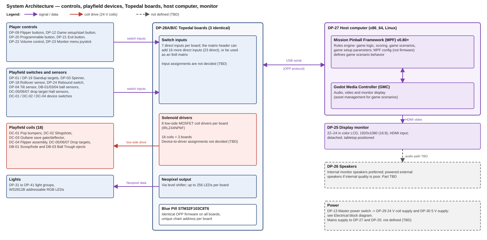

# Machine Master

**Revision:** 20261110-02 · **Date:** 2026-11-10

## System overview

### System

| Topic | Definition |
|---|---|
| Hybrid pinball | Typical pinball playing field used to accomplish game scenario objectives displayed real-time on monitor |
| Physical machine | Portable, tabletop cabinet containing typical pinball devices controlled using modern day electronics + monitor for real-time graphics |
| Game scenarios | Software defined theme packs played on generic playing field |

### Mechanical

| # | Item | Description |
|---|---|---|
| 1 | Cabinet | Baltic birch plywood construction |
| 2 | Materials | COTS materials and fasteners; 3D printed and laser cut custom parts |
| 3 | Access | Hinged playfield (service access); fixed bottom shelf panel; no legs — rubber pads only |

### Electrical

| # | Item | Description |
|---|---|---|
| 1 | Time-critical devices | All solenoid firing runs through the Topedal board's Blue Pill firmware (fire pulse, then PWM hold where used); no hardware autofire (safety). The switches for DC-01 Pop bumpers, DC-02 Slingshots and DC-04 Flipper Assembly are on the same Topedal board as their coils |
| 2 | Non-time-critical devices | Digital switches connected via Topedal board's onboard direct/matrix switch inputs |
| 3 | Rules engine & asset management | Computer supporting MPF + Godot Media Controller (GMC) running Mission Pinball Framework (MPF) — game logic, scoring, game scenarios; GMC for audio/video/monitor display |
| 4 | Comm bus | USB serial between host and Topedal board(s) |

### Software

| # | Item | Description |
|---|---|---|
| 1 | Firmware | Identical OPP firmware flashed to all Topedal boards (same STM32F103 processor as standard OPP), distinguished by board address; MPF config (not firmware) defines game scenario behavior |
| 2 | Game scenarios | A game scenario is defined by populating a Game Scenario Framework — requires no firmware changes |
| 3 | Playing field devices | <b>Primitive</b> — single physical switch/coil/sensor, no sub-components, assigned unique ID. <b>Composite</b> — 2 or more primitives combined to perform one coordinated physical action, e.g., button + coil + EOS sensor = flipper assembly. <b>Ball-state Device</b> — tracks ongoing ball location/count/presence as persistent state, e.g., scoop, ball lock, or trough |
| 4 | Game setup | Players select game preferences before starting a game. Setup parameters include standard parameters applicable to all scenarios + scenario-specific parameters |

## Requirements

### System-Level Requirements

| ID | Title | Definition | Category | Type |
|---|---|---|---|---|
| S-01 | Game play | Playing field ball action and control will be similar to a traditional, full sized pinball machine (1 1/16" dia balls, 40" x 20.5" playing field, 6.5-7 deg slope). Audio, graphics, and video are used to enhance the gaming experience including real-time game scenario progress | Functional | Mandatory |
| S-02 | Game scenarios | System supports user selectable game scenarios. Scenarios have unique themes that use the same generic playing field | Functional | Mandatory |
| S-03 | Game setup parameters | Game parameters will be selected by the player before each game is started. Example parameters include: game difficulty level, number of players, player names, scenario, scenario specific parameters | Functional | Mandatory |
| G-01 | Initialize game | Master power ON, monitor presents setup prompts which player selects | Functional | Mandatory |
| G-02 | Select scoring targets | Player uses onscreen game info to identify best scoring targets | Functional | Mandatory |
| G-03 | Shoot ball | Player launches ball onto playing field using shooter | Functional | Mandatory |
| G-04 | Playing field action | Player uses flippers and programmable buttons (DP-20 Programmable button) to keep ball in play and interact with the game to maximize score | Functional | Mandatory |
| G-05 | Repeat | Repeat steps G-02–G-04 until turn is over | Functional | Mandatory |
| C-01 | Physical | Portable system, played on tabletop, stored in typical household closet | Constraint | Mandatory |
| C-02 | Components | Use COTS parts and materials including modern electronics to replace traditional electro-mechanical, analog devices. Fab and assembly using standard workshop equipment plus 3D printer and 40W laser (24"x12" bed) | Constraint | Mandatory |
| C-03 | Safety | Electrical design will comply with industry-standard safety practices | Constraint | Mandatory |

### Software Requirements — Game Setup Parameters

| ID | Parameter | Scope | Setting | Default | Applies To | Comments |
|---|---|---|---|---|---|---|
| GP-01 | Number of players | Global | 1–4 | 1 | All | — |
| GP-02 | Player name/initials | Per-player | Free text | — | All | Data structure defined in Detailed Design |
| GP-03 | Per-player difficulty tier | Per-player | 1-Clueless 2-Beginner 3-Intermediate 4-Advanced 5-Champion | 3 | All | Data structure defined in Detailed Design |
| GP-04 | Balls per game | Global | 1–10 | 3 | All | — |
| GP-05 | Outlane save budget | Global | 0–5 | 3 | All | — |
| GP-06 | Outlane save time | Global | 0–15 seconds | 5 | All | — |
| GP-07 | Tilt warning count | Global | 0–5 | 3 | All | 0=Disabled |
| GP-08 | Tilt warning sensitivity | Global | 1-Very low 2-Low 3-Medium 4-High 5-Very high | 3 | All | Requires ADC test values |
| GP-09 | Game scenario selection | Global | List of installed scenario IDs | — | All | — |
| GP-10 | Outlane width | TBD | 1-Liberal 2-Normal 3-Difficult | 2 | All | Physical implementation: MD-02 Adjustable outlane pin. Scope TBD pending mechanism decision |

## System architecture

## Device Register

| ID | Device | Tier | Qty | Electrical? | CAD legend symbol |
|---|---|---|---|---|---|
| DB-01 | Scoop/hole | Ball-State Device | 1 | Y | kickout hole (with its inductive metal detector) |
| DB-01 | Scoop/hole |  | X 58.9 mm |  | Y 621.4 mm |
| DB-02 | Ball lock | Ball-State Device | 0–1 (desired) | TBD | none |
| DB-03 | Ball Trough | Ball-State Device | 1 | Y | ball trough / ball feed (with its inductive metal detector) |
| DB-03 | Ball Trough |  | X 172.4 mm |  | Y -36.4 mm |
| DB-04 | Shooter lane ball-present sensor | Ball-State Device | 1 | Y | inductive metal detector (shooter lane) |
| DB-04 | Shooter lane ball-present sensor |  | X 206.9 mm |  | Y -40.8 mm |
| DC-01 | Pop bumpers | Composite Mech | 3 | Y | pop bumper |
| DC-01A | Pop bumpers |  | X -59.2 mm |  | Y 485.2 mm |
| DC-01B | Pop bumpers |  | X 32.5 mm |  | Y 485.2 mm |
| DC-01C | Pop bumpers |  | X -13.4 mm |  | Y 396.5 mm |
| DC-02 | Slingshots | Composite Mech | 2 | Y | sling shot (with 2 leaf switch symbols each) |
| DC-02A | Slingshots |  | X -97.0 mm |  | Y 89.5 mm |
| DC-02A-sw1 | Slingshots |  | X -103.8 mm |  | Y 110.9 mm |
| DC-02A-sw2 | Slingshots |  | X -84.7 mm |  | Y 68.6 mm |
| DC-02B | Slingshots |  | X 97.0 mm |  | Y 89.5 mm |
| DC-02B-sw1 | Slingshots |  | X 103.7 mm |  | Y 110.9 mm |
| DC-02B-sw2 | Slingshots |  | X 84.6 mm |  | Y 68.6 mm |
| DC-03 | Outlane save gate/deflector | Composite Mech | 2 | Y | ball save |
| DC-03A | Outlane save gate/deflector |  | X -167.9 mm |  | Y 4.8 mm |
| DC-03B | Outlane save gate/deflector |  | X 166.1 mm |  | Y 4.8 mm |
| DC-04 | Flipper assembly | Composite Mech | 3 | Y | Flipper |
| DC-04A | Flipper assembly |  | X -149.8 mm |  | Y 236.6 mm |
| DC-04B | Flipper assembly |  | X -73.0 mm |  | Y 0.1 mm |
| DC-04C | Flipper assembly |  | X 73.0 mm |  | Y 0.1 mm |
| DC-05 | Drop target bank (side-by-side) | Composite Mech | 7 | Y | Drop target 7x |
| DC-05A | Drop target bank (side-by-side) |  | X 141.6 mm |  | Y 389.6 mm |
| DC-05B | Drop target bank (side-by-side) |  | X 145.1 mm |  | Y 364.4 mm |
| DC-05C | Drop target bank (side-by-side) |  | X 148.7 mm |  | Y 339.3 mm |
| DC-05D | Drop target bank (side-by-side) |  | X 152.2 mm |  | Y 314.1 mm |
| DC-05E | Drop target bank (side-by-side) |  | X 155.8 mm |  | Y 289.0 mm |
| DC-05F | Drop target bank (side-by-side) |  | X 159.4 mm |  | Y 263.8 mm |
| DC-05G | Drop target bank (side-by-side) |  | X 162.9 mm |  | Y 238.7 mm |
| DC-06 | Drop target (single) | Composite Mech | 1 | Y | drop target 1-blade |
| DC-06 | Drop target (single) |  | X 140.9 mm |  | Y 546.0 mm |
| DC-07 | Drop target bank (inline) | Composite Mech | 4 | Y | drop target 4-blade inline |
| DC-07A | Drop target bank (inline) |  | X -106.3 mm |  | Y 413.2 mm |
| DC-07B | Drop target bank (inline) |  | X -111.2 mm |  | Y 445.9 mm |
| DC-07C | Drop target bank (inline) |  | X -116.2 mm |  | Y 478.5 mm |
| DC-07D | Drop target bank (inline) |  | X -121.1 mm |  | Y 511.2 mm |
| DP-01 | Standup targets (side-by-side) | Primitive | 6 | Y | Standup targets x 6 |
| DP-01A | Standup targets (side-by-side) |  | X 154.8 mm |  | Y 378.6 mm |
| DP-01B | Standup targets (side-by-side) |  | X 158.4 mm |  | Y 353.5 mm |
| DP-01C | Standup targets (side-by-side) |  | X 161.9 mm |  | Y 328.3 mm |
| DP-01D | Standup targets (side-by-side) |  | X 165.5 mm |  | Y 303.2 mm |
| DP-01E | Standup targets (side-by-side) |  | X 169.1 mm |  | Y 278.0 mm |
| DP-01F | Standup targets (side-by-side) |  | X 172.6 mm |  | Y 252.9 mm |
| DP-03 | Spinner | Primitive | 1 | Y | spinner |
| DP-03 | Spinner |  | X -120.2 mm |  | Y 261.5 mm |
| DP-04 | Tilt sensor | Primitive | 1 | Y | tilt bob |
| DP-04 | Tilt sensor |  | X 313.3 mm |  | Y 463.2 mm |
| DP-09 | Flipper buttons | Primitive | 2 | Y | flipper button |
| DP-09L | Flipper buttons |  | X -204.2 mm |  | Y -22.1 mm |
| DP-09R | Flipper buttons |  | X 235.0 mm |  | Y -22.1 mm |
| DP-12 | Game setup/start button | Primitive | 1 | Y | start |
| DP-12 | Game setup/start button |  | X 89.9 mm |  | Y -157.2 mm |
| DP-13 | Master power switch | Primitive | 1 | Y | power on-off |
| DP-13 | Master power switch |  | X 89.9 mm |  | Y -139.1 mm |
| DP-18 | Rollover sensor | Primitive | 7 | Y | inductive metal detector (the 7 on the playfield) |
| DP-18A | Rollover sensor |  | X -164.1 mm |  | Y 575.7 mm |
| DP-18B | Rollover sensor |  | X -57.3 mm |  | Y 575.7 mm |
| DP-18C | Rollover sensor |  | X -13.1 mm |  | Y 575.7 mm |
| DP-18D | Rollover sensor |  | X -167.7 mm |  | Y 104.7 mm |
| DP-18E | Rollover sensor |  | X -140.5 mm |  | Y 104.7 mm |
| DP-18F | Rollover sensor |  | X 140.5 mm |  | Y 104.2 mm |
| DP-18G | Rollover sensor |  | X 168.5 mm |  | Y 104.7 mm |
| DP-19 | Standup target (single) | Primitive | 1 | Y | standup target 1-blade |
| DP-19 | Standup target (single) |  | X -100.6 mm |  | Y 592.9 mm |
| DP-20 | Programmable button | Primitive | 2 | Y | magna-save |
| DP-20L | Programmable button |  | X -204.2 mm |  | Y 28.5 mm |
| DP-20R | Programmable button |  | X 235.0 mm |  | Y 28.5 mm |
| DP-21 | Exit button | Primitive | 1 | Y | exit |
| DP-21 | Exit button |  | X 89.9 mm |  | Y -173.4 mm |
| DP-22 | Volume control | Primitive | 1 | Y | volume control |
| DP-22 | Volume control |  | X 89.9 mm |  | Y -190.5 mm |
| DP-23 | Monitor menu joystick | Primitive | 1 | Y | monitor (video) menu interface/joystick |
| DP-23 | Monitor menu joystick |  | X -135.8 mm |  | Y -157.3 mm |
| DP-24 | Rebound switch (leaf behind rubber ring) | Primitive | 2 | Y | leaf switch (the 2 near the pop bumpers) |
| DP-24A | Rebound switch (leaf behind rubber ring) |  | X 58.0 mm |  | Y 559.9 mm |
| DP-24B | Rebound switch (leaf behind rubber ring) |  | X 98.0 mm |  | Y 515.1 mm |
| DP-25 | Display monitor | System | 1 | Y | display monitor + speakers (box) |
| DP-25 | Display monitor |  | X 15.5 mm |  | Y 733.8 mm |
| DP-26 | Speakers | System | 2 | Y | display monitor + speakers (2 circles) |
| DP-26A | Speakers |  | X -151.3 mm |  | Y 732.4 mm |
| DP-26B | Speakers |  | X 182.0 mm |  | Y 732.4 mm |
| DP-27 | Host computer | System | 1 | Y | Internal Electronics (host computer) |
| DP-27 | Host computer |  | X 278.3 mm |  | Y 540.0 mm |
| DP-28 | Topedal board | System | 3 | Y | Internal Electronics (Topedal control boards 3ea) |
| DP-28A | Topedal board |  | X 308.3 mm |  | Y 540.0 mm |
| DP-28B | Topedal board |  | X 338.3 mm |  | Y 540.0 mm |
| DP-28C | Topedal board |  | X 278.3 mm |  | Y 526.0 mm |
| DP-29 | 24 V coil supply | System | 1 | Y | Internal Electronics (power supply 24v) |
| DP-29 | 24 V coil supply |  | X 308.3 mm |  | Y 526.0 mm |
| DP-30 | 5 V supply | System | 1 | Y | Internal Electronics (power supply 5v) |
| DP-30 | 5 V supply |  | X 338.3 mm |  | Y 526.0 mm |
| DP-31 | Bonus rack lights | Primitive | 15 | Y | lights |
| DP-31-01 | Bonus rack lights |  | X -49.8 mm |  | Y 193.3 mm |
| DP-31-02 | Bonus rack lights |  | X -12.2 mm |  | Y 189.0 mm |
| DP-31-03 | Bonus rack lights |  | X 26.7 mm |  | Y 194.9 mm |
| DP-31-04 | Bonus rack lights |  | X 95.4 mm |  | Y 185.3 mm |
| DP-31-05 | Bonus rack lights |  | X -82.0 mm |  | Y 170.6 mm |
| DP-31-06 | Bonus rack lights |  | X 43.5 mm |  | Y 171.6 mm |
| DP-31-07 | Bonus rack lights |  | X -13.2 mm |  | Y 157.4 mm |
| DP-31-08 | Bonus rack lights |  | X 71.7 mm |  | Y 156.1 mm |
| DP-31-09 | Bonus rack lights |  | X -58.5 mm |  | Y 146.7 mm |
| DP-31-10 | Bonus rack lights |  | X 47.7 mm |  | Y 134.8 mm |
| DP-31-11 | Bonus rack lights |  | X 11.4 mm |  | Y 129.3 mm |
| DP-31-12 | Bonus rack lights |  | X -21.6 mm |  | Y 114.1 mm |
| DP-31-13 | Bonus rack lights |  | X -33.9 mm |  | Y 84.3 mm |
| DP-31-14 | Bonus rack lights |  | X 22.3 mm |  | Y 86.7 mm |
| DP-31-15 | Bonus rack lights |  | X -6.3 mm |  | Y 62.8 mm |
| DP-32 | Drop-target ball lamps | Primitive | 14 | Y | pool ball light |
| DP-32-01 | Drop-target ball lamps |  | X 62.8 mm |  | Y 374.8 mm |
| DP-32-02 | Drop-target ball lamps |  | X 38.3 mm |  | Y 371.2 mm |
| DP-32-03 | Drop-target ball lamps |  | X 66.9 mm |  | Y 348.2 mm |
| DP-32-04 | Drop-target ball lamps |  | X 42.1 mm |  | Y 344.6 mm |
| DP-32-05 | Drop-target ball lamps |  | X 45.8 mm |  | Y 318.5 mm |
| DP-32-06 | Drop-target ball lamps |  | X 70.9 mm |  | Y 322.2 mm |
| DP-32-07 | Drop-target ball lamps |  | X 49.2 mm |  | Y 294.1 mm |
| DP-32-08 | Drop-target ball lamps |  | X 74.6 mm |  | Y 297.8 mm |
| DP-32-09 | Drop-target ball lamps |  | X 52.9 mm |  | Y 268.2 mm |
| DP-32-10 | Drop-target ball lamps |  | X 78.6 mm |  | Y 272.0 mm |
| DP-32-11 | Drop-target ball lamps |  | X 82.4 mm |  | Y 246.9 mm |
| DP-32-12 | Drop-target ball lamps |  | X 56.4 mm |  | Y 243.0 mm |
| DP-32-13 | Drop-target ball lamps |  | X 86.2 mm |  | Y 221.7 mm |
| DP-32-14 | Drop-target ball lamps |  | X 60.0 mm |  | Y 217.9 mm |
| DP-33 | DELUXE letter lights | Primitive | 6 | Y | light |
| DP-33-01 | DELUXE letter lights |  | X 15.3 mm |  | Y 353.0 mm |
| DP-33-02 | DELUXE letter lights |  | X 19.3 mm |  | Y 327.6 mm |
| DP-33-03 | DELUXE letter lights |  | X 23.3 mm |  | Y 302.2 mm |
| DP-33-04 | DELUXE letter lights |  | X 27.3 mm |  | Y 276.8 mm |
| DP-33-05 | DELUXE letter lights |  | X 31.3 mm |  | Y 251.4 mm |
| DP-33-06 | DELUXE letter lights |  | X 35.3 mm |  | Y 226.0 mm |
| DP-34 | ABCD lane feature lights | Primitive | 7 | Y | light |
| DP-34-01 | ABCD lane feature lights |  | X -75.8 mm |  | Y 652.4 mm |
| DP-34-02 | ABCD lane feature lights |  | X -36.4 mm |  | Y 654.7 mm |
| DP-34-03 | ABCD lane feature lights |  | X 2.9 mm |  | Y 652.5 mm |
| DP-34-04 | ABCD lane feature lights |  | X -59.2 mm |  | Y 622.4 mm |
| DP-34-05 | ABCD lane feature lights |  | X -13.6 mm |  | Y 622.4 mm |
| DP-34-06 | ABCD lane feature lights |  | X -140.7 mm |  | Y 149.8 mm |
| DP-34-07 | ABCD lane feature lights |  | X 140.6 mm |  | Y 149.8 mm |
| DP-35 | Left-lane feature lights | Primitive | 7 | Y | light |
| DP-35-01 | Left-lane feature lights |  | X -168.7 mm |  | Y 541.0 mm |
| DP-35-02 | Left-lane feature lights |  | X -161.7 mm |  | Y 421.1 mm |
| DP-35-03 | Left-lane feature lights |  | X -153.9 mm |  | Y 385.4 mm |
| DP-35-04 | Left-lane feature lights |  | X -147.6 mm |  | Y 359.0 mm |
| DP-35-05 | Left-lane feature lights |  | X -140.1 mm |  | Y 332.5 mm |
| DP-35-06 | Left-lane feature lights |  | X -133.5 mm |  | Y 305.8 mm |
| DP-35-07 | Left-lane feature lights |  | X -125.9 mm |  | Y 280.3 mm |
| DP-36 | Bank shot value lights | Primitive | 2 | Y | light |
| DP-36-01 | Bank shot value lights |  | X -95.1 mm |  | Y 357.4 mm |
| DP-36-02 | Bank shot value lights |  | X -89.0 mm |  | Y 327.9 mm |
| DP-37 | DELUXE value lights | Primitive | 2 | Y | light |
| DP-37-01 | DELUXE value lights |  | X -43.9 mm |  | Y 278.7 mm |
| DP-37-02 | DELUXE value lights |  | X -10.7 mm |  | Y 284.0 mm |
| DP-38 | 8-ball saucer chain and outlane special lights | Primitive | 7 | Y | light |
| DP-38-01 | 8-ball saucer chain and outlane special lights |  | X 130.7 mm |  | Y 570.7 mm |
| DP-38-02 | 8-ball saucer chain and outlane special lights |  | X 150.3 mm |  | Y 491.1 mm |
| DP-38-03 | 8-ball saucer chain and outlane special lights |  | X 144.5 mm |  | Y 458.7 mm |
| DP-38-04 | 8-ball saucer chain and outlane special lights |  | X 133.4 mm |  | Y 435.3 mm |
| DP-38-05 | 8-ball saucer chain and outlane special lights |  | X 117.9 mm |  | Y 414.8 mm |
| DP-38-06 | 8-ball saucer chain and outlane special lights |  | X -168.4 mm |  | Y 149.4 mm |
| DP-38-07 | 8-ball saucer chain and outlane special lights |  | X 168.3 mm |  | Y 149.4 mm |
| DP-39 | Bonus, multiplier and shoot-again lights | Primitive | 8 | Y | light |
| DP-39-01 | Bonus, multiplier and shoot-again lights |  | X -33.2 mm |  | Y 33.8 mm |
| DP-39-02 | Bonus, multiplier and shoot-again lights |  | X -0.0 mm |  | Y 33.8 mm |
| DP-39-03 | Bonus, multiplier and shoot-again lights |  | X 33.1 mm |  | Y 33.8 mm |
| DP-39-04 | Bonus, multiplier and shoot-again lights |  | X -40.9 mm |  | Y 9.9 mm |
| DP-39-05 | Bonus, multiplier and shoot-again lights |  | X 42.6 mm |  | Y 9.9 mm |
| DP-39-06 | Bonus, multiplier and shoot-again lights |  | X -12.8 mm |  | Y -6.4 mm |
| DP-39-07 | Bonus, multiplier and shoot-again lights |  | X 14.3 mm |  | Y -6.4 mm |
| DP-39-08 | Bonus, multiplier and shoot-again lights |  | X -0.0 mm |  | Y -35.0 mm |
| DP-40 | Pop bumper lights | Primitive | 3 | Y | star |
| DP-40-01 | Pop bumper lights |  | X -59.2 mm |  | Y 485.2 mm |
| DP-40-02 | Pop bumper lights |  | X 32.5 mm |  | Y 485.2 mm |
| DP-40-03 | Pop bumper lights |  | X -13.4 mm |  | Y 396.5 mm |
| DP-41 | General illumination lights | Primitive | 32 | Y | post light |
| DP-41-01 | General illumination lights |  | X -161.1 mm |  | Y 668.2 mm |
| DP-41-02 | General illumination lights |  | X 153.3 mm |  | Y 673.6 mm |
| DP-41-03 | General illumination lights |  | X 186.1 mm |  | Y 645.8 mm |
| DP-41-04 | General illumination lights |  | X -168.9 mm |  | Y 629.5 mm |
| DP-41-05 | General illumination lights |  | X 93.4 mm |  | Y 634.7 mm |
| DP-41-06 | General illumination lights |  | X -123.0 mm |  | Y 600.7 mm |
| DP-41-07 | General illumination lights |  | X 144.6 mm |  | Y 590.6 mm |
| DP-41-08 | General illumination lights |  | X 57.6 mm |  | Y 580.6 mm |
| DP-41-09 | General illumination lights |  | X -79.3 mm |  | Y 577.2 mm |
| DP-41-10 | General illumination lights |  | X -35.3 mm |  | Y 577.2 mm |
| DP-41-11 | General illumination lights |  | X 9.2 mm |  | Y 577.2 mm |
| DP-41-12 | General illumination lights |  | X 90.1 mm |  | Y 576.7 mm |
| DP-41-13 | General illumination lights |  | X -98.7 mm |  | Y 538.4 mm |
| DP-41-14 | General illumination lights |  | X 177.9 mm |  | Y 518.4 mm |
| DP-41-15 | General illumination lights |  | X 121.8 mm |  | Y 508.0 mm |
| DP-41-16 | General illumination lights |  | X -144.7 mm |  | Y 479.5 mm |
| DP-41-17 | General illumination lights |  | X 107.3 mm |  | Y 456.6 mm |
| DP-41-18 | General illumination lights |  | X 172.9 mm |  | Y 448.1 mm |
| DP-41-19 | General illumination lights |  | X -76.9 mm |  | Y 434.8 mm |
| DP-41-20 | General illumination lights |  | X -137.3 mm |  | Y 425.3 mm |
| DP-41-21 | General illumination lights |  | X 172.9 mm |  | Y 401.4 mm |
| DP-41-22 | General illumination lights |  | X 172.9 mm |  | Y 366.9 mm |
| DP-41-23 | General illumination lights |  | X -169.1 mm |  | Y 283.9 mm |
| DP-41-24 | General illumination lights |  | X -164.8 mm |  | Y 197.2 mm |
| DP-41-25 | General illumination lights |  | X 170.6 mm |  | Y 203.0 mm |
| DP-41-26 | General illumination lights |  | X -118.7 mm |  | Y 116.6 mm |
| DP-41-27 | General illumination lights |  | X 118.6 mm |  | Y 116.6 mm |
| DP-41-28 | General illumination lights |  | X -100.6 mm |  | Y 59.9 mm |
| DP-41-29 | General illumination lights |  | X 100.6 mm |  | Y 59.9 mm |
| DP-41-30 | General illumination lights |  | X -115.1 mm |  | Y 24.4 mm |
| DP-41-31 | General illumination lights |  | X 113.3 mm |  | Y 25.4 mm |
| DP-41-32 | General illumination lights |  | X -119.9 mm |  | Y -39.2 mm |
| MC-01 | Cabinet body | Mechanical | Per CAD | N | none |
| MC-02 | Hinged playfield support | Mechanical | Per CAD | N | none |
| MC-03 | Glass top and slide retention | Mechanical | Per CAD | N | none |
| MC-04 | Bottom shelf | Mechanical | Per CAD | N | none |
| MC-05 | Rubber feet | Mechanical | Per CAD | N | none |
| MD-01 | Playfield post | Mechanical | Per CAD (not tracked) | N | post tapered, post shaft |
| MD-02 | Adjustable outlane pin | Mechanical | 2 | N | adjustable outlane pin |
| MD-02A | Adjustable outlane pin |  | X 176.0 mm |  | Y 137.8 mm |
| MD-02B | Adjustable outlane pin |  | X -178.7 mm |  | Y 136.3 mm |
| MG-01 | Ball guides | Mechanical | Per CAD (not tracked) | N | ball guide plexiglass standoff |
| MG-02 | Apron | Mechanical | 1 | N | none |
| ML-01 | Shooter plunger + spring | Mechanical | 1 | N | manual shooter plunger + spring |
| ML-01 | Shooter plunger + spring |  | X 206.4 mm |  | Y -105.5 mm |
