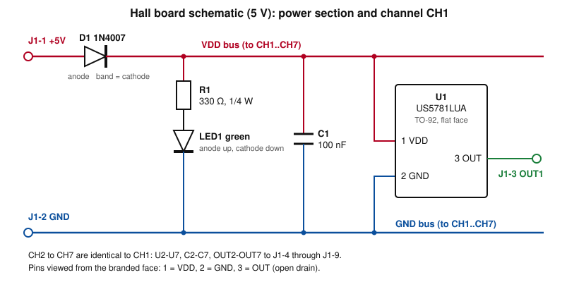
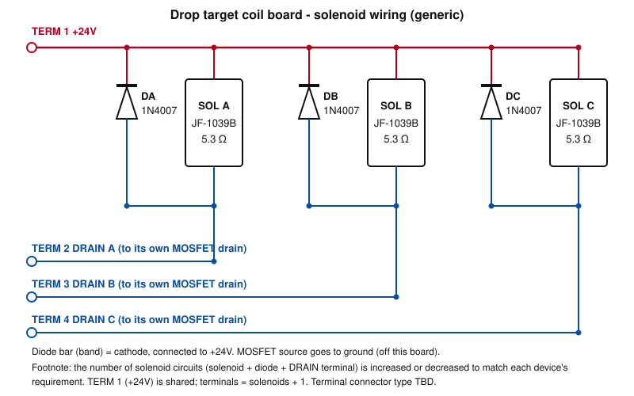

# Drop Targets — Common Components

**Applies to:** DC-05 Drop target bank (side-by-side), DC-06 Drop target (single), DC-07 Drop target bank (inline)
**Source:** `pmdd_drop-target_20261103-01` (Claude Project), migrated 2026-11-11
**Rule:** Parameters shared by all three devices are held here once. Each device README holds only its differences.

## Functions, constraints, parameters

| Item | Value |
|---|---|
| Function | Target drops on a ball hit; resets via a solenoid-driven lifter arm |
| Supply | Sensors 5 V (P-06) through the Hall board; solenoids 24 V (P-02) |
| Sensor | Melexis US5781LUA-AAA-000-BU Hall-effect switch (TO-92), one per blade, in the bracket floor; ~2 mm nominal flush gap; one Hall board design serves DC-05 (7 channels), DC-06 (1) and DC-07 (up to 4) |
| Magnet position | In the blade bottom tab, south pole toward the sensor branded face |
| Actuator | JF-1039B, 12 V-rated, 10 mm stroke, push-pull; solenoids lift through one common rod and share the load equally |
| Plunger spring | None. OEM plunger spring and C-clip removed on all drop targets |
| Drive | 24 V (P-02); full-power fire to end of stroke (plunger fully retracted), PWM hold for 25–30 ms dwell, then release; hold duty bench-tuned; all solenoids on the common lifting rod fire together. Return spring and overtravel limit: TBD |
| Lifter | Pivoting lifter arm per blade, 3 mm axle pivot on ball side of blade; one common 3 mm lifting rod under all lifter arms and through the 3 mm hole in each solenoid plunger; pivot-to-blade CL 73.05 mm; pivot-to-rod 33.82 mm; blade rests and slides on arm top edge; 22 mm blade lift (20 mm latched height + 2 mm overtravel); per-arm lift-height adjustment screw |
| Blade | PLA; flush position set by blade lip; bottom tab ~6 mm deep × 10.5 mm high × 9 mm wide (depth per sensor decision); arm-contact edge radiused; lip underside sloped 15°, rising toward blade. One blade design for DC-05, DC-06 and DC-07 |
| Mounting | 3D-printed one-piece bracket; lip ledge sloped 15° to match lip underside, high corner radiused |
| Return spring (catalog data) | McMaster-Carr 9665K84 cut-to-length extension spring: 302 stainless steel, 0.25" OD, 0.015" wire, 20" stock; catalog minimum load 0.04 lb, rate 0.004 lbf/in at 20". Cut length per device |
| Spring attachment | 3D-printed cutout pegs; spring end loops slip over the pegs; peg positions follow the actual spring length |
| Forward bias | Cable tie per DP-01 Standup targets (side-by-side), cantilever flexure acting on blade near lip height; target 0.03–0.05 lbf forward force |
| Protection | 1N4007, one per solenoid, across its own coil on the coil board; band toward +24 V |
| Coil termination | Coil board at the solenoid end of the bracket, away from the Hall board; one terminal connector, type TBD (TERM 1 = +24 V shared by all solenoids; TERM 2 onward = one DRAIN terminal per solenoid, each to the drain of that solenoid's own MOSFET); solenoid circuits (solenoid, diode, DRAIN terminal) are added or removed to match the device |

## Magnet and Hall switch specifications

| Spec | Value |
|---|---|
| Magnet part (DC-05, DC-06) | SRENMSMT round neodymium magnet (N48), 6×2 mm |
| Magnet part (DC-07) | Generic rare-earth magnet, 4×4 mm, COTS (Amazon) |
| Magnet coating | Not recorded |
| Magnet magnetization direction | Not recorded |
| Magnet surface field at 2 mm gap | Not recorded |
| US5781 supply | VDD 3.5–24 V operating (Melexis US5781 Rev 016, 13 Jun 2019, §6) |
| US5781 operate point | BOP 7 / 12 / 15 mT (min / typ / max); TA 25 °C, VDD 12 V (Melexis US5781 Rev 016, 13 Jun 2019) |
| US5781 release point | BRP 3.5 / 7.5 / 10 mT (min / typ / max); TA 25 °C, VDD 12 V (Melexis US5781 Rev 016, 13 Jun 2019) |

| Magnet state | OUT |
|---|---|
| South pole facing the branded face, field above BOP | Pulled to GND (VDSon 0.3 / 0.5 V typ / max at 20 mA) |
| Magnet away, field below BRP | Open |

## Parts

| Part | Number | Supplier | Datasheet |
|---|---|---|---|
| Hall-effect switch | Melexis US5781LUA-AAA-000-BU (TO-92 flat) | Not recorded | [Melexis US5781, Rev 016](https://www.melexis.com/en/documents/documentation/datasheets/datasheet-us5781) |
| Magnet (DC-05, DC-06) | SRENMSMT 6×2 mm round neodymium | Not recorded | None |
| Magnet (DC-07) | Generic 4×4 mm rare-earth | Amazon | None |
| Solenoid | JF-1039B, coil about 5.2–5.4 Ω | Not recorded | None; no manufacturer datasheet |
| Return spring | McMaster-Carr 9665K84 | McMaster-Carr | [9665K84](https://www.mcmaster.com/9665K84/) |
| Diode (coil board D, Hall board D1) | 1N4007 (1N4001 acceptable substitute on the Hall board) | Not recorded | [Vishay 1N4001–1N4007](https://www.vishay.com/docs/88503/1n4001.pdf) |
| Hall board connector J1 | 9-position screw terminal, 5.08 mm pitch | Not recorded | None |
| Coil board connector TERM | Type TBD | — | — |

## Schematics

Interim drawings; to be replaced by KiCad eCAD schematics.

### Hall board (5 V, 7 channels)

One board design serves DC-05 (7 channels), DC-06 (1) and DC-07 (up to 4). Channels CH2–CH7 are identical to CH1 (U2–U7, C2–C7, OUT2–OUT7).

| Net | Connects |
|---|---|
| +5V | J1-1, D1 anode |
| VDD bus | D1 cathode, R1 (top), U1–U7 pin 1, C1–C7 (top) |
| GND | J1-2, LED1 cathode, U1–U7 pin 2, C1–C7 (bottom) |
| LED1 anode | R1 (bottom) |
| OUT1–OUT7 | U1–U7 pin 3, J1-3 to J1-9 |

| Part | Qty | Value | Notes |
|---|---|---|---|
| U1–U7 | 7 | Melexis US5781LUA-AAA-000-BU | Pins viewed from the branded face: 1 = VDD, 2 = GND, 3 = OUT (open drain) |
| D1 | 1 | 1N4007 | One shared series reverse-protection diode, band on the sensor side (Melexis US5781 Rev 016 §13); about 0.7 V drop (Melexis Rev 016 §13), VDD at the sensors about 4.3 V; 1N4001 is an acceptable substitute |
| C1–C7 | 7 | 100 nF | At each sensor's pins, VDD to GND (Melexis US5781 Rev 016 §13) |
| R1 | 1 | 330 Ω, ¼ W | LED current limit, about 7 mA at 4.3 V |
| LED1 | 1 | Green | Power-on indicator; Vf about 2 V; anode toward R1 |
| J1 | 1 | 9-position screw terminal, 5.08 mm pitch | 1 = +5V, 2 = GND, 3–9 = OUT1–OUT7 |

### Coil board (generic)

One drawing serves all three drop targets; the number of solenoid circuits is set per device. Three solenoid circuits are shown.

| Net | Connects |
|---|---|
| +24V | TERM 1, top lead of SOL A, SOL B and SOL C, DA, DB and DC bands |
| DRAIN A | TERM 2, SOL A bottom lead, DA anode; to the drain of solenoid A's own MOSFET |
| DRAIN B | TERM 3, SOL B bottom lead, DB anode; to the drain of solenoid B's own MOSFET |
| DRAIN C | TERM 4, SOL C bottom lead, DC anode; to the drain of solenoid C's own MOSFET |

| Part | Qty | Value | Notes |
|---|---|---|---|
| TERM 1–4 | 4 | Terminal connector, type TBD | 1 = +24V, 2 = DRAIN A, 3 = DRAIN B, 4 = DRAIN C |
| DA, DB, DC | 3 | 1N4007 | One per solenoid, across its own coil; band toward +24V |
| SOL A, SOL B, SOL C | 3 | JF-1039B | Coil about 5.2–5.4 Ω |
