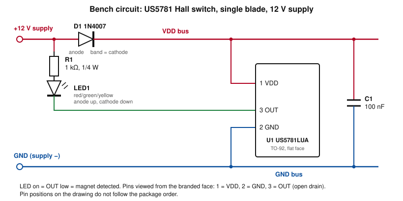

# Test — Single-Blade Prototype Hall Sensor (12 V, 6×2 mm Magnet)

## Header

| Field | Value |
|---|---|
| File | pmdd_test_20261105-02_single_blade_hall_sensor.md |
| Test date | 2026-10-14 |
| Revision date | 2026-11-05 |
| Tester | Scott |
| Devices | DC-05 Drop target bank (7 side-by-side), DC-06 Drop target (single), DC-07 Drop target bank (4 inline) (single-blade prototype) |

## Setup

| Item | Value |
|---|---|
| Sensor | Melexis US5781 Hall-effect switch, perf-board mounted |
| Magnet | 6×2mm (SRENMSMT, N48) in blade bottom tab |
| Prototype | Single-blade drop target |
| Supply | 12 V (Scott, 2026-11-05) |
| Circuit | Single-blade 12 V circuit (Scott, 2026-11-05); schematic below |

### Bench circuit

Figure 1 — Single-blade 12 V bench circuit (same circuit as pmdd_test_20261105-01_us5781_hall_effect_detect_distance, per Scott, 2026-11-05: the first single-blade circuit with the 6×2 magnet used a 12 V supply).

| Net | Connects |
|---|---|
| +12V | Supply +, D1 anode, R1 (top) |
| VDD bus | D1 cathode, U1 pin 1, C1 (top) |
| GND | Supply −, U1 pin 2, C1 (bottom) |
| LED1 anode | R1 (bottom) |
| OUT | U1 pin 3, LED1 cathode |

| Ref | Qty | Value | Notes |
|---|---|---|---|
| U1 | 1 | Melexis US5781LUA-AAA-000-BU | TO-92 flat. Pins viewed from the branded face: 1 = VDD, 2 = GND, 3 = OUT (open drain) |
| D1 | 1 | 1N4007 | Series reverse-protection diode, band toward U1 |
| C1 | 1 | 100 nF | At the sensor pins, VDD to GND |
| R1 | 1 | 1 kΩ, ¼ W | LED current limit, about 9.5 mA at 12 V |
| LED1 | 1 | Red, green or yellow | Output indicator; Vf about 2 V; anode toward R1; lit when OUT is low |

### Deviations from the final design

| Item | Bench circuit | Final design (Hall board, drop-target §3) | Reason |
|---|---|---|---|
| Supply | 12 V (source not stated) | 5 V through D1, P-06 | Test condition; 12 V is the datasheet operate-point condition |
| R1 | 1 kΩ | 330 Ω | Sized for 12 V |
| LED | Output indicator: R1 from +12 V to OUT, lit when OUT is low | Power-on indicator: R1 from VDD to GND | Detection read-out |
| Channels | 1 | 7 (DC-05), 1 (DC-06), up to 4 (DC-07) | Single-blade prototype |
| Output | LED; not read by a controller | OUT to a Topedal direct input (pin assignment not yet defined in the PMDD Assignment Table) | Bench observation |
| Magnet | 6×2 mm SRENMSMT | 6×2 mm for DC-05 and DC-06; 4×4 mm for DC-07 | Not a deviation for DC-05 and DC-06 |

## Data

| Item | Result |
|---|---|
| Sensor + magnet function on prototype | Functioning correctly |
| Gap, field, scope data | Not provided |

## Interpretation

- Hall sensor (perf board) + 6×2mm magnet detects blade position correctly on the single-blade prototype.

## Supersedes

- pmdd_test_20261014-01_single_blade_hall_sensor: data and interpretation unchanged; supply (12 V), bench schematic, net and parts tables and Deviations table added.
