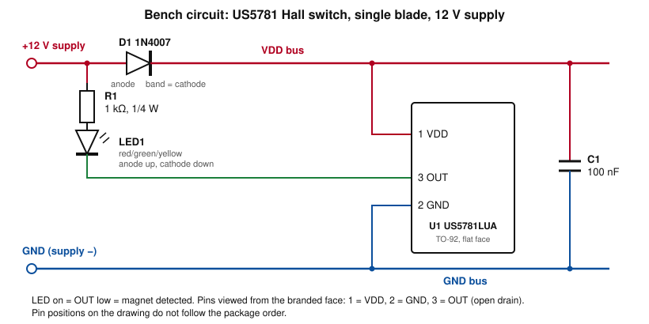

# Test — US5781 Hall Effect Switch Detection Distance (12 V, Single Blade, 6×2 mm Magnet)

## Header

| Field | Value |
|---|---|
| Test date | 2026-10-12 |
| Revision date | 2026-11-05 |
| Original ID | TR-20261012-03 |
| Tester | Scott |
| Devices | DC-05 Drop target bank (7 side-by-side), DC-06 Drop target (single), DC-07 Drop target bank (4 inline) (blade-position sensor) |

## Setup

| Item | Value |
|---|---|
| Sensor | Melexis US5781LUA-AAA-000-BU (TO-92 flat), open-drain output |
| Magnet | SRENMSMT round neodymium, 6×2mm |
| Pole orientation | South pole toward the sensor branded face |
| Supply | 12 V |
| Circuit | Single-blade circuit (Scott, 2026-11-05); schematic below |
| Method | Magnet-to-sensor distance recorded where the LED turns on |
| Intervening material | None (air), 2mm wood panel, 3.3mm plywood |
| Measurement accuracy | ±1mm |

### Bench circuit

Figure 1 — Single-blade 12 V bench circuit (drawn from the Setup text of the original test doc; confirmed as the single-blade 12 V circuit by Scott, 2026-11-05).

| Net | Connects |
|---|---|
| +12V | Supply +, D1 anode, R1 (top) |
| VDD bus | D1 cathode, U1 pin 1, C1 (top) |
| GND | Supply −, U1 pin 2, C1 (bottom) |
| LED1 anode | R1 (bottom) |
| OUT | U1 pin 3, LED1 cathode |

| Ref | Qty | Value | Notes |
|---|---|---|---|
| U1 | 1 | Melexis US5781LUA-AAA-000-BU | TO-92 flat. Pins viewed from the branded face: 1 = VDD, 2 = GND, 3 = OUT (open drain) |
| D1 | 1 | 1N4007 | Series reverse-protection diode, band toward U1 |
| C1 | 1 | 100 nF | At the sensor pins, VDD to GND |
| R1 | 1 | 1 kΩ, ¼ W | LED current limit, about 9.5 mA at 12 V |
| LED1 | 1 | Red, green or yellow | Output indicator; Vf about 2 V; anode toward R1; lit when OUT is low |

### Deviations from the final design

| Item | Bench circuit | Final design (Hall board, drop-target §3) | Reason |
|---|---|---|---|
| Supply | 12 V (source not stated) | 5 V through D1, P-06 | Test condition; 12 V is the datasheet operate-point condition |
| R1 | 1 kΩ | 330 Ω | Sized for 12 V |
| LED | Output indicator: R1 from +12 V to OUT, lit when OUT is low | Power-on indicator: R1 from VDD to GND | Detection read-out |
| Channels | 1 | 7 (DC-05), 1 (DC-06), up to 4 (DC-07) | Single-blade prototype |
| Output | LED; not read by a controller | OUT to a Topedal direct input (pin assignment not yet defined in the PMDD Assignment Table) | Bench observation |
| Magnet | 6×2 mm SRENMSMT | 6×2 mm for DC-05 and DC-06; 4×4 mm for DC-07 | Not a deviation for DC-05 and DC-06 |

## Data

| Condition | Sensor ON at (mm) |
|---|---|
| Clear air gap | 6 |
| 2mm wood panel between magnet and sensor | 5 |
| 3.3mm plywood between magnet and sensor | 4 |

## Interpretation

| Point | Finding |
|---|---|
| Margin to design gap | ON at 6mm in air against the 2mm nominal flush gap: 4mm of distance margin (±1mm) |
| Release distance | Not recorded; not a concern because the blade moves the magnet 20mm away from the sensor |
| Panel readings | Wood and plywood are non-magnetic, so no attenuation is expected; the 5mm and 4mm readings overlap the 6mm air reading only at 5mm within ±1mm. Whether each reading is total magnet-to-sensor distance or air gap plus panel was not stated |
| Supply voltage | 12 V, the condition at which the datasheet specifies the operate point (BOP 7 / 12 / 15 mT min / typ / max) |

**Caveats**

| Item | Note |
|---|---|
| Field strength | Not measured; margin is stated in distance, not in mT |
| Readings | One value per condition provided; no repeat readings |
| Measurement of panel cases | Reference point for the reported distance (total versus air gap) not stated |

## Supersedes

- pmdd_test_20261012-03_us5781_detect_distance (Test TR-20261012-03): renamed to include Hall effect; data and interpretation unchanged; bench schematic, net and parts tables, Deviations table and standard section layout added; reference to the superseded drop-target schematic removed.
