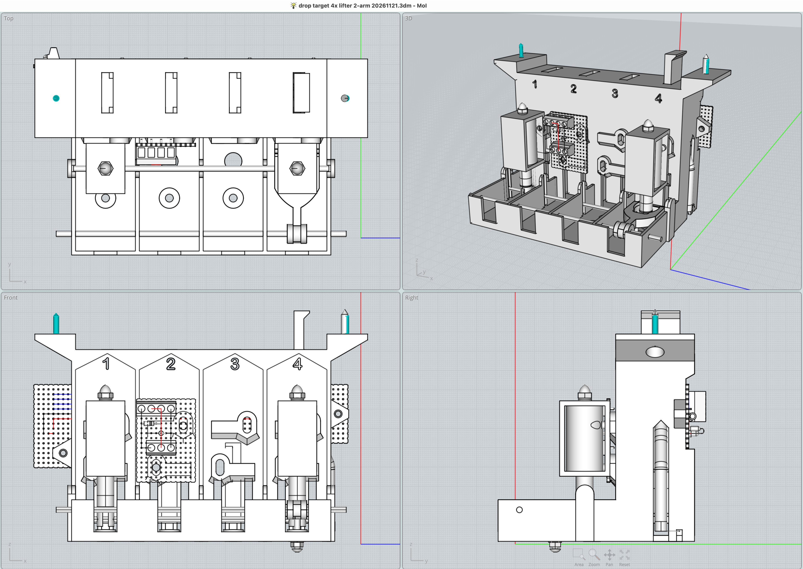
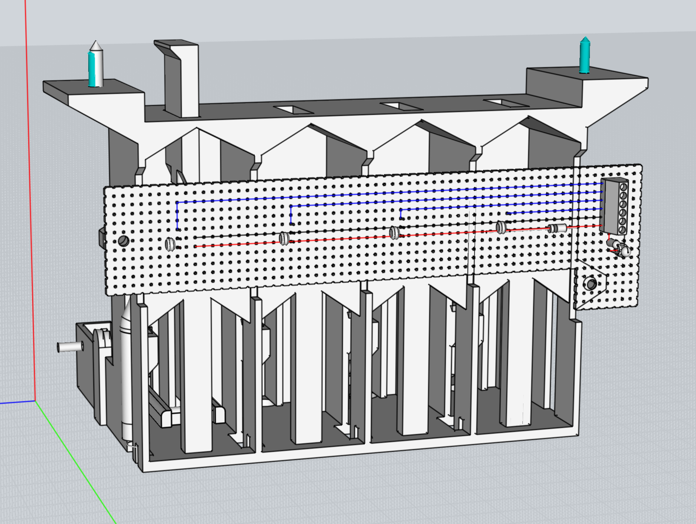
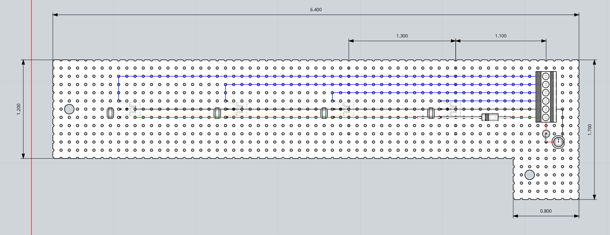
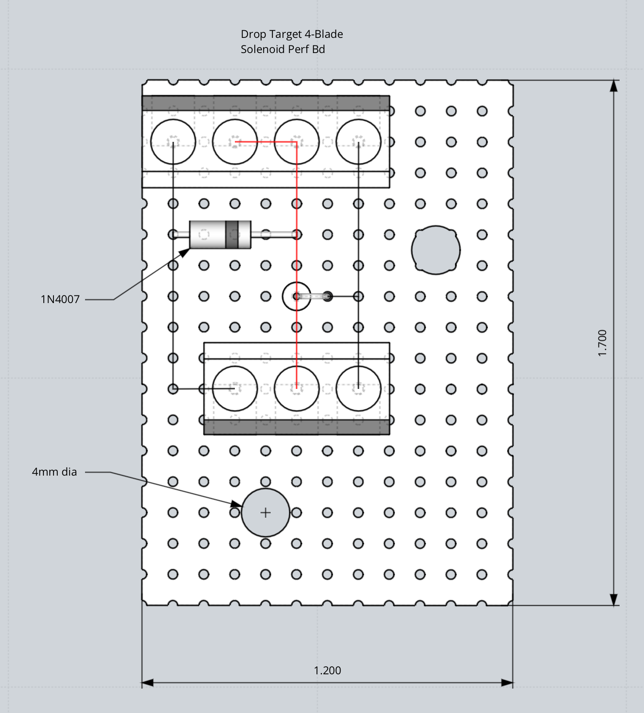

# Test — Drop Target 4-Blade Lift, 12 V Bench, 1 vs 2 Solenoids

**Revision:** 20261122-01

## Header

| Field | Value |
|---|---|
| Test ID / name | Drop target 4-blade lift test, 12 V bench, 1 vs 2 solenoids |
| Device | DC-07 Drop target bank (inline) |
| Date | 2026-11-22 |
| Tester | Scott |
| Revision | 20261122-01 |

## Test Setup

| Item | Value |
|---|---|
| Unit | 4-blade drop target prototype (lifter 2-arm design, Moi 3D model 20261121) |
| Solenoids | 2, one at each end of the bank (locations 1 and 4) |
| Supply | Bench supply, 12 V |
| Hall effect sensor perf board and solenoid perf board | Attached per the drawings below |
| Not provided | Solenoid model, drive duration or PWM, supply current, which single location was used in the 1-solenoid runs |

## Results

| Test Title / Description | Requirement | Result | Pass / Fail |
|---|---|---|---|
| 2 solenoids (locations 1 and 4): raise 4 blades | Not provided | All 4 blades consistently raised | PASS |
| 1 solenoid: raise 4 blades | Not provided | Unable to raise 4 blades | FAIL |
| 1 solenoid: raise 3 blades | Not provided | Marginally raises 3 blades | Marginal (no Pass / Fail assigned) |
| 1 solenoid: raise 2 blades | Not provided | Raises 2 blades | PASS |

## Deviations

| Item | Test | Final design | Reason |
|---|---|---|---|
| Solenoid supply | 12 V bench supply | 24 V (P-02), common components | Default bench setup until the machine power supply is designed and tested |

## Drawings

| Drawing | File |
|---|---|
| Design views (top, 3D, front, right), Moi 3D 20261121 |  |
| Rear 3D view with Hall effect sensor perf board |  |
| Hall effect sensor perf board (6.4 × 1.7 in) |  |
| Solenoid perf board (1.2 × 1.7 in), 1N4007 |  |

## Supersedes

- None.
