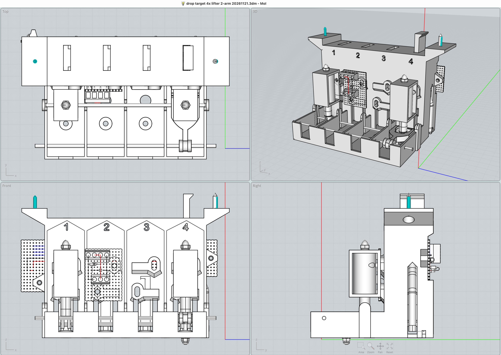
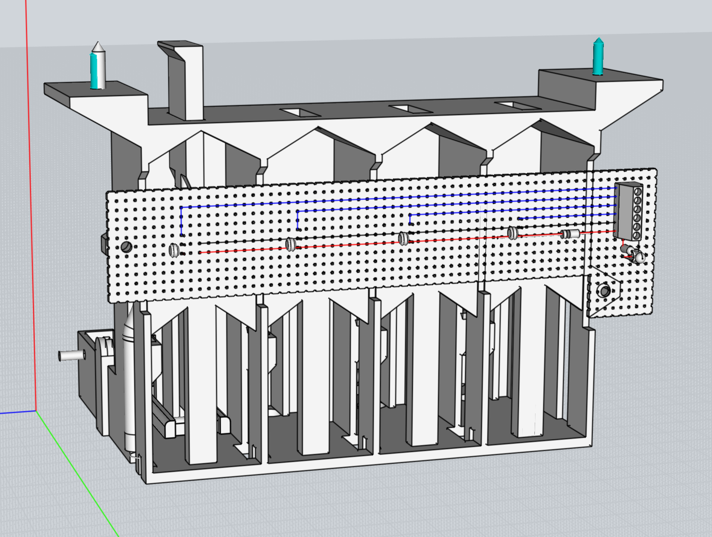
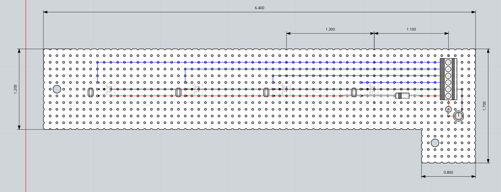
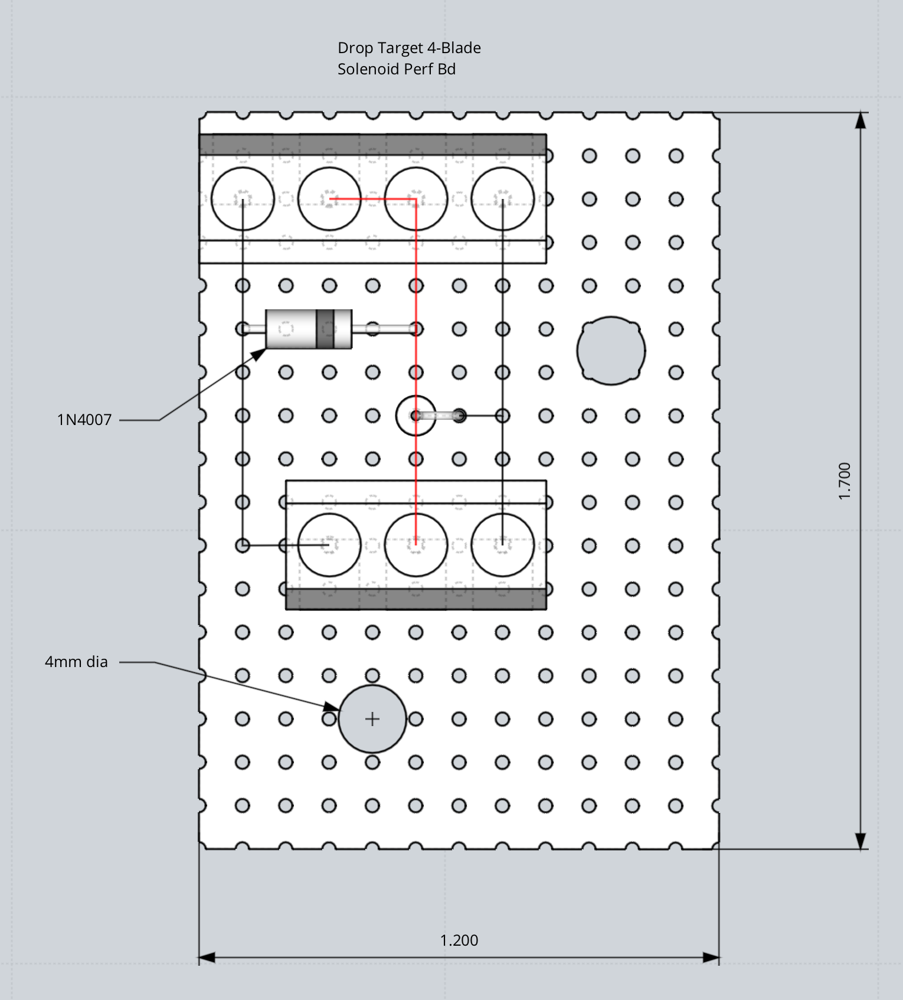

# Test — Drop Target 4-Blade Lift, 12 V Bench, 1 vs 2 Solenoids

**Revision:** 20261122-02

## Header

| Field | Value |
|---|---|
| Test ID / name | Drop target 4-blade lift test, 12 V bench, 1 vs 2 solenoids |
| Device | DC-07 Drop target 4-blade (inline) |
| Date | 2026-11-22 |
| Tester | Scott |
| Revision | 20261122-02 |

## Test Setup

| Item | Value |
|---|---|
| Unit | 4-blade drop target prototype (lifter 2-arm design, Moi 3D model 20261121) |
| Solenoids | 2, one at each end of the bank (locations 1 and 4) |
| Supply | Bench supply, 12 V |
| Hall effect sensor perf board and solenoid perf board | Attached per the drawings below |
| Solenoid | JF-1039B (drop-target common default) |
| Not recorded | Drive duration/PWM, supply current, and which single end was used in the 1-solenoid runs |

## Results

| Test Title / Description | Requirement | Result | Pass / Fail |
|---|---|---|---|
| Raise 4 blades with 2 solenoids | 2 solenoids @ 24 V (max) raise 4 blades | All 4 blades consistently raised (2 solenoids, locations 1 and 4; 12 V bench supply) | PASS |
| Hall effect sensor trips at flush | Hall effect sensor triggers when the blade drops to the flush position | Sensor triggers at the flush position | PASS |

Evidence note: the 4-blade raise was demonstrated at 12 V bench supply (see Deviations); 24 V is the design supply maximum. The single-blade solenoid test records functional operation from about 8 V to 12 V with 12 V "more than enough" (tests/test_drop_target_single_blade_solenoid.md).

## Solenoid count determination (1-solenoid observations)

Basis for the 2-solenoid count. One solenoid at a single end:

| Blades lifted with 1 solenoid | Result |
|---|---|
| 4 blades | Unable to raise — FAIL |
| 3 blades | Marginally raises |
| 2 blades | Raises — PASS |

Outcome: 2 solenoids are required for reliable 4-blade lift, one at each end (locations 1 and 4).

## Deviations

| Item | Test | Final design | Reason |
|---|---|---|---|
| Solenoid supply | 12 V bench supply | 24 V (P-02), common components | Default bench setup until the machine power supply is designed and tested |

## Drawings

| Drawing | File |
|---|---|
| Design views (top, 3D, front, right), Moi 3D 20261121 |  |
| Rear 3D view with Hall effect sensor perf board |  |
| Hall effect sensor perf board (6.4 × 1.7 in) |  |
| Solenoid perf board (1.2 × 1.7 in), 1N4007 |  |

## Supersedes

- test_drop_target_4blade_two_solenoid_lift.md 20261122-01
