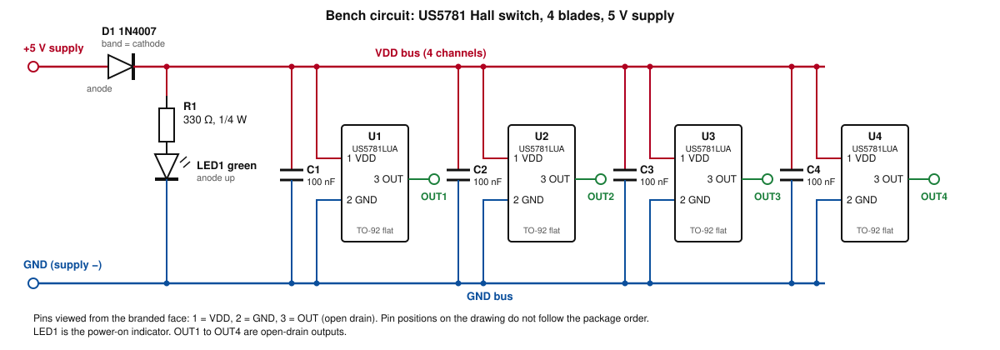

# Test — Hall Sensor with 4×4mm Magnet, Detect Distance (5 V, 4 Blades)

## Header

| Field | Value |
|---|---|
| Test date | 2026-10-31 |
| Revision date | 2026-11-05 |
| Tester | Scott |
| Devices | DC-07 Drop target bank (4 inline) |

## Setup

| Item | Value |
|---|---|
| Sensor | Melexis US5781 Hall-effect switch, perf-board mounted, 1.3" blade module pitch (sensor location compatible with 0.1" perf-board hole spacing) |
| Magnet | Generic rare-earth 4×4mm (COTS, Amazon) in the blade bottom tab |
| Supply | 5 V regulated bench supply through the series diode D1 (1N4007), about 4.3 V at the sensors (calculated; measured VDD not provided) |
| Circuit | 4-blade circuit (Scott, 2026-11-05); schematic below |

### Bench circuit

Figure 1 — 4-blade 5 V bench circuit (drawn from the drop target Hall board schematic cut to 4 channels; 4-blade circuit and 5 V supply per Scott, 2026-11-05).

| Net | Connects |
|---|---|
| +5V | Supply +, D1 anode |
| VDD bus | D1 cathode, R1 (top), U1–U4 pin 1, C1–C4 (top) |
| GND | Supply −, LED1 cathode, U1–U4 pin 2, C1–C4 (bottom) |
| LED1 anode | R1 (bottom) |
| OUT1–OUT4 | U1–U4 pin 3 |

| Ref | Qty | Value | Notes |
|---|---|---|---|
| U1–U4 | 4 | Melexis US5781LUA-AAA-000-BU | TO-92 flat. Pins viewed from the branded face: 1 = VDD, 2 = GND, 3 = OUT (open drain) |
| D1 | 1 | 1N4007 | One shared series reverse-protection diode, band toward the sensors; about 4.3 V at the sensors (calculated, not measured) |
| C1–C4 | 4 | 100 nF | At each sensor's pins, VDD to GND |
| R1 | 1 | 330 Ω, ¼ W | LED current limit |
| LED1 | 1 | Green | Power-on indicator; anode toward R1 |

### Deviations from the final design

| Item | Bench circuit | Final design (Hall board, drop-target §3) | Reason |
|---|---|---|---|
| Supply | Regulated bench supply, 5 V | P-06 fused 5 V supply | Bench testing uses a regulated bench supply until the machine supply is complete (Scott, 2026-10-31) |
| Channels | 4 | 7 (DC-05), 1 (DC-06), up to 4 (DC-07) | 4-blade circuit; matches DC-07 |
| Output | Observation method not provided | OUT to a Topedal direct input (pin assignment not yet defined in the PMDD Assignment Table) | Bench observation |
| Connector | Not provided | 9-position screw terminal J1 | Bench wiring |

## Data

| Item | Result |
|---|---|
| Sensor + 4×4mm magnet function | Successful |
| Maximum detect distance | Approximately 10 mm |
| Designed (flush) gap | 2mm (unchanged) |

| Item | Result |
|---|---|
| Measured sensor VDD, magnet field, pole orientation, measurement reference for the 10mm distance, channels exercised | Not provided |

## Interpretation

- The sensor, powered through D1, triggers reliably with the 4×4mm magnet at the 2mm designed gap, with approximately 10 mm of detect range.
- Magnet placement directly over the sensor is the only critical tolerance (Scott).
- Circuit: 4-blade circuit at 5 V. A 7-blade prototype with the 6×2mm magnet is not built; it will use this circuit design with 7 channels at 5 V (Scott, 2026-11-05).

## Supersedes

- pmdd_test_20261031-02_hall_4x4_magnet_detect: data unchanged; circuit identified as the 4-blade 5 V circuit (replaces "1-blade module" wording); bench schematic, net and parts tables and Deviations table added. Complements pmdd_test_20261105-02_single_blade_hall_sensor (6×2mm magnet, 12 V).
