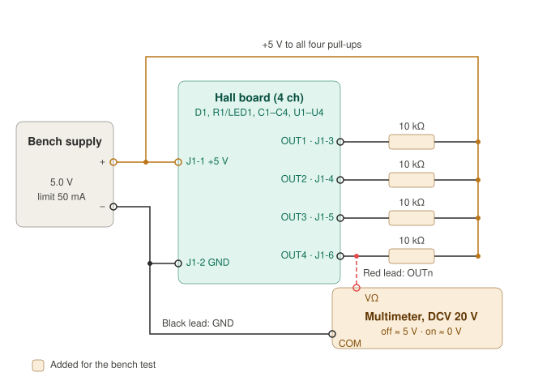
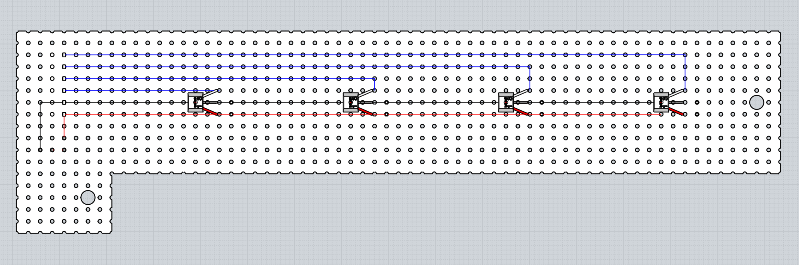
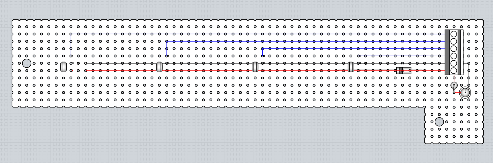
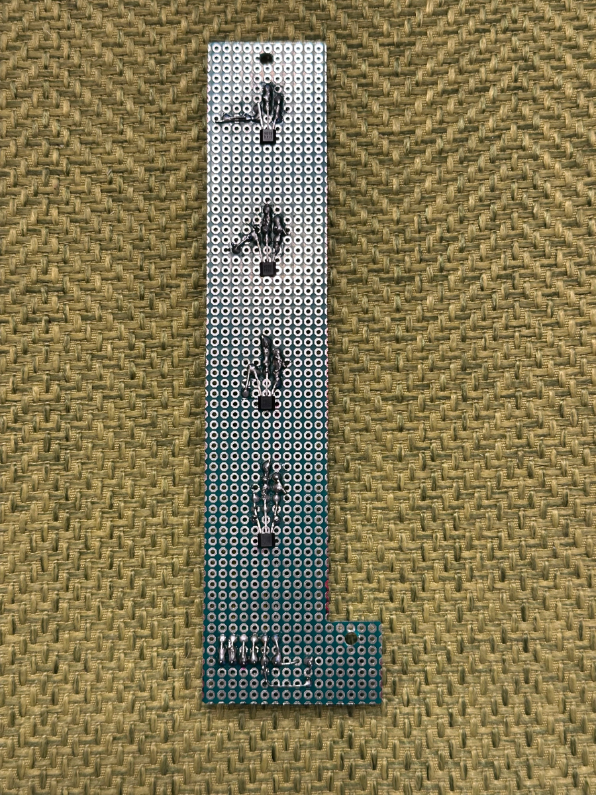
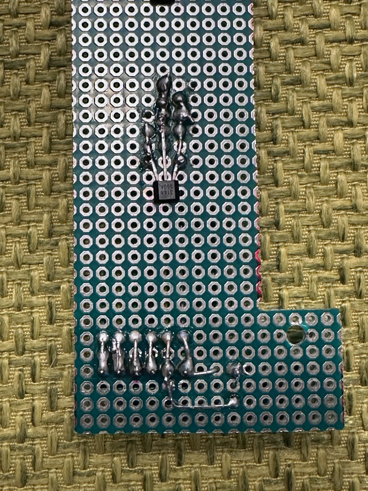
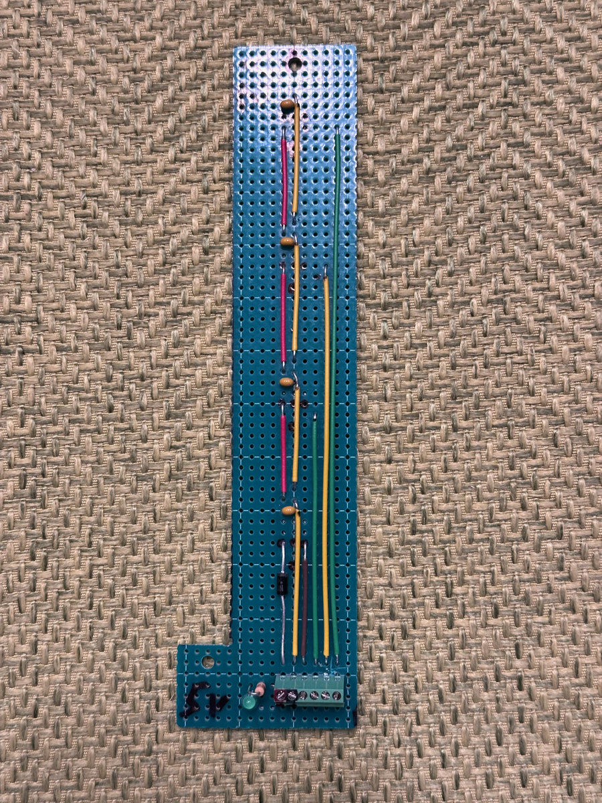
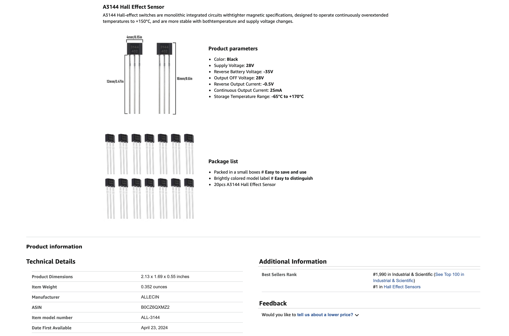

# Test — Drop Target 4-Blade Hall Perf Board v2, Bench Test (5 V, A3144 Sensors, 4×4mm Magnet)

**Revision:** 20261124-01

## Header

| Field | Value |
|---|---|
| Test ID / name | Drop target 4-blade Hall perf board v2 bench test |
| Device | DC-07 Drop target 4-blade (inline) |
| Date | 2026-11-24 (reported by Scott; bench test date not stated) |
| Tester | Scott |
| Revision | 20261124-01 |

## Test Setup

| Item | Value |
|---|---|
| Unit | Hall effect sensor perf board labeled v2 (4 channels), bench tested stand-alone; no blades or solenoids |
| Sensors | Generic A3144 Hall effect sensor, Amazon (ALLECIN, model ALL-3144, ASIN B0CZ6QXMZ2), 4 each. A3144 alternate design sensor; the preferred design uses the US5781 (see Deviations) |
| Magnet | Generic rare-earth 4×4mm (COTS, Amazon) |
| Supply | Bench supply, 5 V, through D1 (1N4007); VDD at the sensors 4.3 V (Scott, 2026-11-24) |
| Circuit | Bench circuit below; setup matches the drawing (Scott) |
| Test method | Magnet moved toward each sensor face; output observed with the multimeter on DC volts (OUTn to GND) |
| Not recorded | Pole orientation, per-sensor distances, how the 7mm distance was measured |

### Bench circuit

Figure 1 — Bench test setup: 5 V supply, Hall perf board v2, one 10 kΩ pull-up per output, multimeter.

| Net | Connects |
|---|---|
| +5V | Supply +, J1-1, one end of each 10 kΩ pull-up |
| GND | Supply −, J1-2, multimeter COM |
| OUT1–OUT4 | J1-3 to J1-6, other end of the matching 10 kΩ pull-up |
| Multimeter VΩ | OUTn under test (moved from channel to channel) |

| Ref | Qty | Value | Notes |
|---|---|---|---|
| Hall perf board v2 | 1 | 4 channels | D1 1N4007 (as tested), R1 with green LED1, C1–C4 100 nF, U1–U4 A3144, 6-position 0.1" terminal block (photos below) |
| Pull-up | 4 | 10 kΩ, ¼ W | Test fixture, one per output (open-drain/open-collector output needs a pull-up for the meter reading) |
| Multimeter | 1 | DC volts, 20 V range | Off ≈ 5 V, on ≈ 0 V expected |

### Deviations from the final design

| Item | Bench circuit | Final design (Hall board, drop-target §3) | Reason |
|---|---|---|---|
| Sensor | Generic A3144 (Amazon) | US5781 (preferred); A3144 is the alternate design (common components) | Generic sensor from Amazon; v2 board built with it (Scott, 2026-11-24) |
| D1 | 1N4007 | A3144 alternate design: 1N5817 | 1N4007 leaves 4.3 V at the sensors, below the A3144 4.5 V minimum; 1N5817 swap not yet fitted or tested |
| Output | 10 kΩ pull-up to +5 V, read with a multimeter | OUT to a Topedal direct input (pin assignment not yet defined in the PMDD Assignment Table) | Bench observation |
| Supply | Bench supply, 5 V | P-06 fused 5 V supply | Bench testing uses a bench supply until the machine supply is complete |
| Magnet and blade | Hand-held 4×4mm magnet, no blade | Magnet in the blade bottom tab | Sensor-only test |

## Results

| Test Title / Description | Requirement | Result | Pass / Fail |
|---|---|---|---|
| Sensor 1 triggers with the 4×4mm magnet | Triggers with the 4×4mm magnet (numeric requirement not stated; designed gap 2mm) | Triggered at approximately 7 mm from the sensor face | PASS |
| Sensor 2 triggers with the 4×4mm magnet | Same | Triggered at approximately 7 mm from the sensor face | PASS |
| Sensor 3 triggers with the 4×4mm magnet | Same | Triggered at approximately 7 mm from the sensor face | PASS |
| Sensor 4 triggers with the 4×4mm magnet | Same | Triggered at approximately 7 mm from the sensor face | PASS |

Result obtained with VDD at the sensors 4.3 V, below the A3144 operating minimum of 4.5 V (Allegro). Outcome: all four sensors PASS. The Hall effect sensor perf board labeled v2 passed the bench test.

## Sensor reference: generic A3144 (Amazon listing)

Source: the seller listing (unofficial; saved as `test_hall_perf_bd_v2_bench_a3144_listing.png`). Parameters as listed; the listing's reverse output value is shown as "-0.5V" for a current item. The device marking in the photos reads 3144 (the listing shows 3144 402). The generic part's conformance to the Allegro A3141-A3144 datasheet is not verified.

| Parameter | Listing value |
|---|---|
| Supply voltage | 28 V |
| Reverse battery voltage | -35 V |
| Output OFF voltage | 28 V |
| Continuous output current | 25 mA |
| Storage temperature | -65°C to +170°C |
| Package | TO-92 flat; lead lengths 12 mm and 16 mm versions shown |

Allegro A3141, A3142, A3143 and A3144 datasheet (manufacturer): supply voltage operating range 4.5 to 24 V; absolute maximum VCC 28 V, output current 25 mA continuous.

## Drawings and photos

| Item | File |
|---|---|
| Perf board layout, bottom (solder side) |  |
| Perf board layout, top (component side) |  |
| Photo, bottom (sensors) |  |
| Photo, bottom detail (sensor and terminal block joints) |  |
| Photo, top (D1, LED1, R1, C1–C4, terminal block) |  |
| A3144 Amazon listing |  |

## Supersedes

- None. Complements test_hall_4x4_magnet_detect (US5781 sensors, 4×4mm magnet, approximately 10 mm detect range) and test_drop_target_4blade_two_solenoid_lift (Hall perf board attached to the 4-blade prototype).
