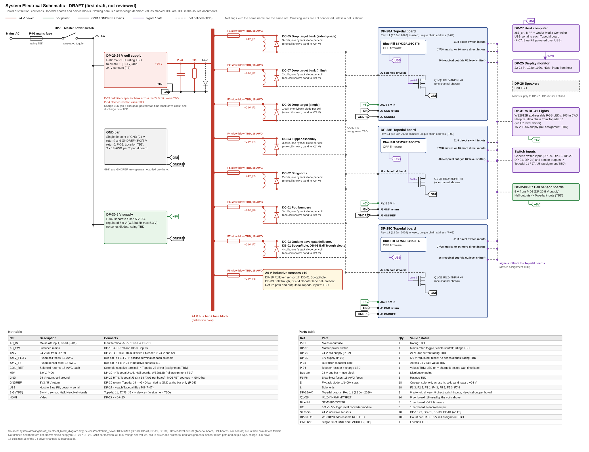

# Electrical Master

**Revision:** 20261112-01 · **Date:** 2026-11-12

## Block diagram

## Schematic

First draft. Supplies, bus bar, fused feeds F1 to F8, GND bar, Topedal boards and device blocks. Pin assignments (device-to-driver, device-to-input) are not decided and are not drawn. The Topedal board circuit is the DP-28 device schematic: [draft_schematic.svg](../devices/controllers_power/dp-28_topedal_board/draft_schematic.svg).
