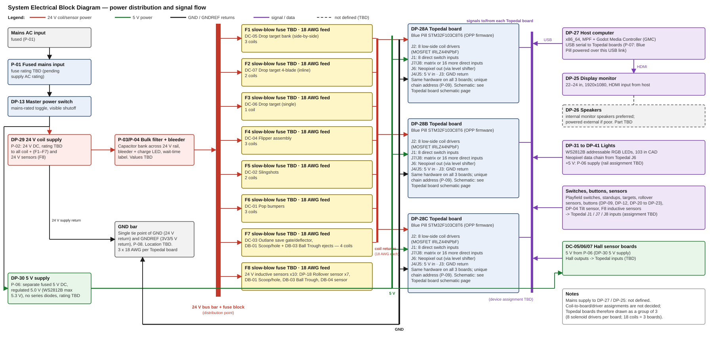

# Electrical Master

**Revision:** 20261125-02 · **Date:** 2026-11-25

## Block diagram

## Schematic

First draft. Supplies, bus bar, fused feeds F1 to F8, GND bar, Topedal boards and device blocks. Pin assignments (device-to-driver, device-to-input) are not decided and are not drawn. The Topedal board circuit is the DP-28 device schematic: [draft_schematic.svg](../devices/controllers_power/dp-28_topedal_board/draft_schematic.svg).

## Safety architecture

Industry-standard, defense-in-depth electrical safety (requirement C-03). Protection is organized in three tiers by scope, below an AC-mains tier. Each tier is independent, and the default state on any loss of control or power is **coils OFF**.

| Tier | Scope | Protection |
|---|---|---|
| Mains | Whole machine | Fused + switched AC inlet (F_AC, DP-13 Master power switch), chassis earth bond, GFCI (portable use) |
| Tier 1 | Coil rail (all 18 coils) | F_MAIN; K1 master coil-rail cutoff — opens on firmware-watchdog timeout **or** a firmware fault command; 24 V rail-current stuck-on detect; bulk capacitor + bleeder (P-03/P-04) |
| Tier 2 | One circuit / feed | Circuit fuses F1–F8 and the 5 V rail fuses — clear a hard short and isolate one branch |
| Tier 3 | One device | Fail-safe default: each coil driver's gate pulldown holds the MOSFET OFF on loss of signal or power; flyback diode per coil; 24 V sensor inputs clamped to 3.3 V; LEDs de-energize with 5 V loss; GND/GNDREF single star tie |

**Stuck coil or shorted driver (≈4.5 A):** cleared by the firmware rail-current detection dropping K1, not by a fuse — a fuse rated to pass the fire pulse will not open at 4.5 A. **Hard shorts (tens of A):** cleared by the circuit fuses. No per-coil fuses are used; the circuit fuses plus K1 and rail-current detection cover the coil hazards. This is consistent with the no-hardware-autofire rule (Machine Master, Electrical): all firing runs through board firmware.

### Circuit fuse table

One fused feed per circuit. All ratings are set during the power-supply and coil-coordination design tasks (bench thermal-withstand, test DC-06) and are left blank until defined.

| Fuse | Tier | Circuit / feed | Coils | Rating |
|---|---|---|---|---|
| F_AC | Mains | AC mains input (P-01) | — | TBD |
| F_MAIN | 1 | 24 V coil rail, ahead of K1 and the fuse block | — | TBD |
| F1 | 2 | DC-05 Drop target bank (side-by-side) | 3 | TBD |
| F2 | 2 | DC-07 Drop target 4-blade (inline) | 2 | TBD |
| F3 | 2 | DC-06 Drop target (single) | 1 | TBD |
| F4 | 2 | DC-04 Flipper assembly | 3 | TBD |
| F5 | 2 | DC-02 Slingshots | 2 | TBD |
| F6 | 2 | DC-01 Pop bumpers | 3 | TBD |
| F7 | 2 | DC-03 Outlane save gate/deflector + DB-01 Scoop/hole, DB-03 Ball Trough ejects | 4 | TBD |
| F8 | 2 | 24 V inductive sensors x10 (DP-18 x7, DB-01, DB-03, DB-04) | — | TBD |
| F_5V_LOGIC | 2 | 5 V logic rail (DP-28 Topedal boards, Hall boards, switch inputs) | — | TBD |
| F_5V_LED | 2 | 5 V lighting rail (WS2812B addressable LEDs, ~103) | — | TBD |

Coils on F1–F7 total 18 (power-budget counts; the DC-05 and DC-07 coil counts are confirmed by bench test). F8 carries no coils. K1 cuts only the 24 V coil rail; the F8 sensor feed is separate.

## Grounding architecture

Single-point **star ground** at the GND bar (P-08). Return classes are kept separate until they meet at the star, and the system bonds to earth at one point.

- **Return classes to the star:** 24 V coil returns (heavy, 18 AWG per coil), LED 5 V return (heavy, ~6 A), per-device gate return (GNDREF), logic GNDREF (clean), and the 24 V sensor returns. 24 V GND, GNDREF and LED GND meet only at GND★.
- **Single earth bond:** GND★ bonds to chassis / mains protective earth (PE) at one point; GFCI protection depends on this bond.
- **Per-device gate return:** each co-located driver's gate reference (GNDREF) is a dedicated wire to the star, separate from its 4.5 A coil return, so the coil-return drop cannot shift the MOSFET gate reference.
- **Host ground:** the host PC is mains-earthed and powers the Blue Pills over USB (P-07), so its USB ground ties logic GNDREF to the same earth reference. If a ground loop appears, add a USB isolator.
