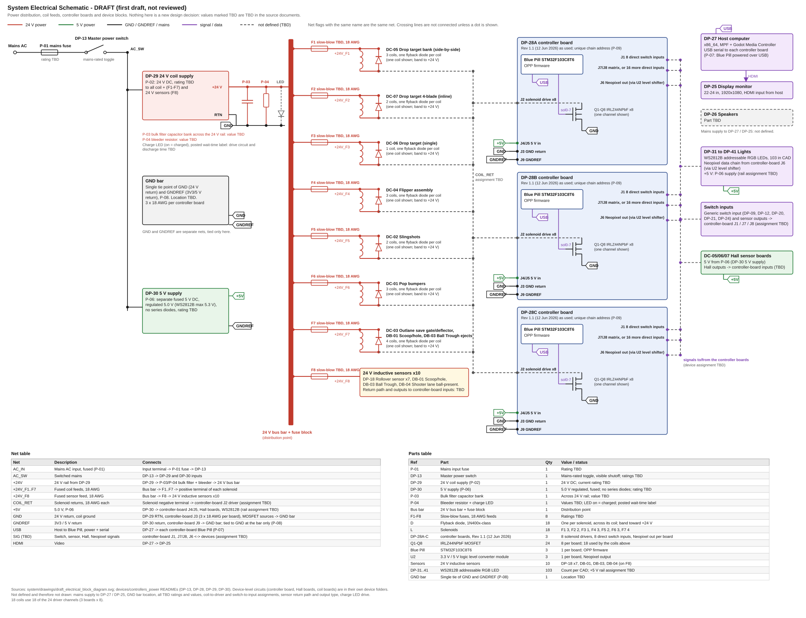
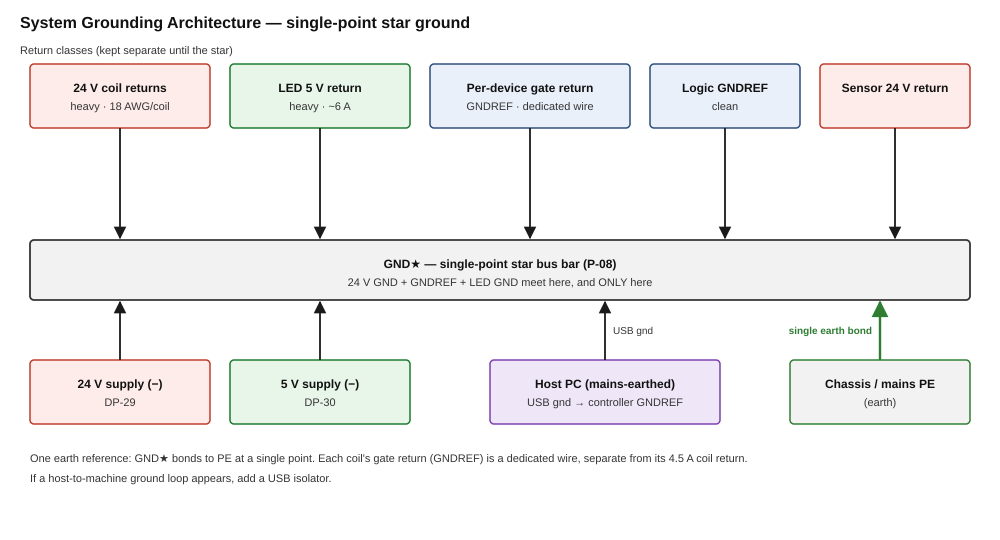

# Electrical Master

**Revision:** 20261126-01 · **Date:** 2026-11-26

## Block diagram

## Schematic

First draft. Supplies, bus bar, fused feeds F1 to F8, GND bar, controller boards and device blocks. Pin assignments are not drawn; see [I/O map](#io-map). The controller board circuit is the DP-28 device schematic: [draft_schematic.svg](../devices/controllers_power/dp-28_controller_board/draft_schematic.svg).

## Safety architecture

Industry-standard, defense-in-depth electrical safety (requirement C-03). Protection is organized in three tiers by scope, below an AC-mains tier. Each tier is independent, and the default state on any loss of control or power is **coils OFF**.

| Tier | Scope | Protection |
|---|---|---|
| Mains | Whole machine | Fused + switched AC inlet (F_AC, DP-13 Master power switch), chassis earth bond, GFCI (portable use) |
| Tier 1 | Coil rail (all 18 coils) | F_MAIN; K1 master coil-rail cutoff — opens on firmware-watchdog timeout **or** a firmware fault command; 24 V rail-current stuck-on detect; bulk capacitor + bleeder (P-03/P-04) |
| Tier 2 | One circuit / feed | Circuit fuses F1–F8 and the 5 V rail fuses — clear a hard short and isolate one branch |
| Tier 3 | One device | Fail-safe default: each coil driver's gate pulldown holds the MOSFET OFF on loss of signal or power; flyback diode per coil; 24 V sensor inputs clamped to 3.3 V; LEDs de-energize with 5 V loss; GND/GNDREF single star tie |

**Stuck coil or shorted driver (≈4.5 A):** cleared by the firmware rail-current detection dropping K1, not by a fuse — a fuse rated to pass the fire pulse will not open at 4.5 A. **Hard shorts (tens of A):** cleared by the circuit fuses. No per-coil fuses are used; the circuit fuses plus K1 and rail-current detection cover the coil hazards. This is consistent with the no-hardware-autofire rule (Machine Master, Electrical): all firing runs through board firmware.

### Circuit fuse table

One fused feed per circuit. All ratings are set during the power-supply and coil-coordination design tasks (bench thermal-withstand, test DC-06) and are left blank until defined.

| Fuse | Tier | Circuit / feed | Coils | Rating |
|---|---|---|---|---|
| F_AC | Mains | AC mains input (P-01) | — | TBD |
| F_MAIN | 1 | 24 V coil rail, ahead of K1 and the fuse block | — | TBD |
| F1 | 2 | DC-05 Drop target bank (side-by-side) | 3 | TBD |
| F2 | 2 | DC-07 Drop target 4-blade (inline) | 2 | TBD |
| F3 | 2 | DC-06 Drop target (single) | 1 | TBD |
| F4 | 2 | DC-04 Flipper assembly | 3 | TBD |
| F5 | 2 | DC-02 Slingshots | 2 | TBD |
| F6 | 2 | DC-01 Pop bumpers | 3 | TBD |
| F7 | 2 | DC-03 Outlane save gate/deflector + DB-01 Scoop/hole, DB-03 Ball Trough ejects | 4 | TBD |
| F8 | 2 | 24 V inductive sensors x10 (DP-18 x7, DB-01, DB-03, DB-04) | — | TBD |
| F_5V_LOGIC | 2 | 5 V logic rail (DP-28 controller boards, Hall boards, switch inputs) | — | TBD |
| F_5V_LED | 2 | 5 V lighting rail (WS2812B addressable LEDs, ~103) | — | TBD |

Coils on F1–F7 total 18 (power-budget counts; the DC-05 and DC-07 coil counts are confirmed by bench test). F8 carries no coils. K1 cuts only the 24 V coil rail; the F8 sensor feed is separate.

## Grounding architecture

Single-point **star ground** at the GND bar (P-08). Return classes are kept separate until they meet at the star, and the system bonds to earth at one point.

- **Return classes to the star:** 24 V coil returns (heavy, 18 AWG per coil), LED 5 V return (heavy, ~6 A), logic GNDREF (clean, carries the per-device gate returns), and the 24 V sensor returns. 24 V GND, GNDREF and LED GND meet only at GND★.
- **Single earth bond:** GND★ bonds to chassis / mains protective earth (PE) at one point; GFCI protection depends on this bond.
- **Per-device gate return:** each co-located driver's gate reference (GNDREF) pairs with its gate wire back to the controller board and joins the controller's logic GNDREF; the controller makes the single GNDREF tie to the star (conventional remote gate drive). The gate return is kept a separate conductor from the 4.5 A coil return — joined only through that controller tie — so the coil-return drop cannot shift the MOSFET gate reference. (Refines the 2026-11-25 D17 decision, which had GNDREF as a per-device dedicated wire to the star; applies to all co-located drivers.)
- **Host ground:** the host PC is mains-earthed and powers the Blue Pills over USB (P-07), so its USB ground ties logic GNDREF to the same earth reference. If a ground loop appears, add a USB isolator.

## Board architecture

Coil drivers are **co-located with their device**, not on a shared controller board. The DP-28 controller board (one Blue Pill + 8 on-board drivers + I/O + Neopixel) is superseded for production by two board types:

- **Controller board** — Blue Pill (STM32F103, OPP firmware), switch/matrix inputs, Neopixel output + level shifter, 5 V distribution, GNDREF star tie, and one gate-drive output per coil channel.
- **Per-device coil-driver board** — co-located at each coil: MOSFET (IRLZ44N), gate network (100 Ω series + 10 kΩ pulldown-to-GNDREF + 100 kΩ pulldown-to-source backup), flyback diode, screw terminals ([coil_driver_board.md](system_common_components/coil_driver_board.md)). The gate signal runs from the controller board; the coil-return runs its own wire to the GND★ star, while the gate-return (GNDREF) pairs with the gate wire back to the controller board (conventional remote gate drive) and joins the star only through the controller's single logic-GNDREF tie.

Firing still runs through controller-board firmware (the gate is firmware-driven), so the no-hardware-autofire rule (Machine Master, Electrical) is preserved. The DP-28 OPP reference board and the Cobrapin board are the design references for the custom PCBs; both board types are to be designed, and **DC-06 Drop target (single) is the first prototype**.

## I/O map

Controller boards DP-28A, DP-28B, DP-28C; OPP firmware; Blue Pill pins as printed on the board silkscreen. ▶n = coil gate output, OPP solenoid number. Pin = DP-28 controller board J100 pin number.

| Pin | Silk | OPP bit | DP-28A Controller board (lower) | DP-28B Controller board (top) | DP-28C Controller board (right) |
|---|---|---|---|---|---|
| **Header 1** | | | | | |
| 1 | B12 | 1 | DP-09L Flipper button L | DC-01A Pop bumper switch | spare (in) |
| 2 | B13 | 2 | DP-09R Flipper button R | DC-01B Pop bumper switch | spare (in) |
| 3 | B14 | 3 | DP-12 Start button | DC-01C Pop bumper switch | DC-06 Drop target (single) Hall |
| 4 | B15 | 4 | LED data out | LED data out | LED data out |
| 5 | A8 | 5 | ▶1 DC-02A Slingshot L | ▶1 DC-01A Pop bumper | ▶1 DC-06 Drop target (single) |
| 6 | A9 | 6 | ▶2 DC-02B Slingshot R | ▶2 DC-01B Pop bumper | spare (out ▶2) |
| 7 | A10 | 7 | ▶3 DB-03 Ball trough eject | ▶3 DC-01C Pop bumper | spare (out ▶3) |
| 8 | A11 | none | USB | USB | USB |
| 9 | A12 | none | USB | USB | USB |
| 10 | A15 | 8 | DC-02A-sw1 Slingshot L switch 1 | DP-24A Rebound switch | spare (in) |
| 11 | B3 | 9 | DC-02A-sw2 Slingshot L switch 2 | DP-24B Rebound switch | spare (in) |
| 12 | B4 | 10 | DC-02B-sw1 Slingshot R switch 1 | DP-19 Standup target (single) | spare (in) |
| 13 | B5 | 11 | DC-02B-sw2 Slingshot R switch 2 | spare (in) | spare (in) |
| 14 | B6 | 12 | ▶4 DC-04A Flipper upper-L | ▶4 DC-07 Drop target inline, coil 1 | ▶4 DC-05 Drop target bank, coil 1 |
| 15 | B7 | 13 | ▶5 DC-04B Flipper lower-L | ▶5 DC-07 Drop target inline, coil 2 | ▶5 DC-05 Drop target bank, coil 2 |
| 16 | B8 | 14 | ▶6 DC-04C Flipper lower-R | ▶6 DB-01 Scoop eject | ▶6 DC-05 Drop target bank, coil 3 |
| 17 | B9 | 15 | spare (out ▶7) | spare (out ▶7) | spare (out ▶7) |
| 18 | 5V | none | power | power | power |
| 19 | G | none | ground | ground | ground |
| 20 | 3.3 | none | power | power | power |
| **Header 2** | | | | | |
| 21 | VB | none | not assigned | not assigned | not assigned |
| 22 | C13 | 17 | DP-21 Exit button | spare (in) | spare (in) |
| 23 | C14 | 18 | spare (in) | spare (in) | spare (in) |
| 24 | C15 | 19 | spare (in) | spare (in) | DP-01A Standup target |
| 25 | A0 | 20 | ▶8 DC-03A Outlane save L | spare (in) | DP-01B Standup target |
| 26 | A1 | 21 | ▶9 DC-03B Outlane save R | spare (in) | DP-01C Standup target |
| 27 | A2 | 22 | spare (out ▶10) | spare (in) | DP-01D Standup target |
| 28 | A3 | 23 | spare (out ▶11) | spare (in) | DP-01E Standup target |
| 29 | A4 | 24 | DP-18D Rollover, L outlane | DC-07A Drop target inline Hall | DP-01F Standup target |
| 30 | A5 | 25 | DP-18E Rollover, L inlane | DC-07B Drop target inline Hall | DC-05A Drop target bank Hall |
| 31 | A6 | 26 | DP-18F Rollover, R inlane | DC-07C Drop target inline Hall | DC-05B Drop target bank Hall |
| 32 | A7 | 27 | DP-18G Rollover, R outlane | DC-07D Drop target inline Hall | DC-05C Drop target bank Hall |
| 33 | B0 | 28 | DB-03 Ball trough sensor | DP-18A Rollover, top | DC-05D Drop target bank Hall |
| 34 | B1 | 29 | DB-04 Shooter lane sensor | DP-18B Rollover, top | DC-05E Drop target bank Hall |
| 35 | B10 | 30 | DP-20L Programmable button L | DP-18C Rollover, top | DC-05F Drop target bank Hall |
| 36 | B11 | 31 | DP-20R Programmable button R | DB-01 Scoop sensor | DC-05G Drop target bank Hall |
| 37 | R | none | reset | reset | reset |
| 38 | 3.3 | none | power | power | power |
| 39 | G | none | ground | ground | ground |
| 40 | G | none | ground | ground | ground |
| **4-pin end header** | | | | | |
| 41 | GND | none | ST-Link | ST-Link | ST-Link |
| 42 | SWCLK | 16 | ST-Link | ST-Link | ST-Link |
| 43 | SWIO | 0 (▶0) | ST-Link | ST-Link | ST-Link |
| 44 | 3V3 | none | ST-Link | ST-Link | ST-Link |

### Wing configuration

OPP direction is set per wing.

| Wing | Pins | DP-28A | DP-28B | DP-28C |
|---|---|---|---|---|
| W0 | SWIO, B12–B15, A8–A10 | NEO_SOL | NEO_SOL | NEO_SOL |
| W1 | A15, B3–B9 | SOL | SOL | SOL |
| W2 | SWCLK, C13–C15, A0–A3 | SOL | INP | INP |
| W3 | A4–A7, B0, B1, B10, B11 | INP | INP | INP |

### Firing links

Input and coil are on the same controller board.

| Input | Coil |
|---|---|
| DP-09L Flipper button L | DC-04A Flipper upper-L, DC-04B Flipper lower-L |
| DP-09R Flipper button R | DC-04C Flipper lower-R |
| DC-02A-sw1, -sw2 Slingshot L switches | DC-02A Slingshot L |
| DC-02B-sw1, -sw2 Slingshot R switches | DC-02B Slingshot R |
| DC-01A, B, C Pop bumper switches | Matching DC-01A, B, C Pop bumper |

### Spare pins

| Board | Spare inputs | Spare outputs |
|---|---|---|
| DP-28A | C14, C15 (2) | B9 ▶7, A2 ▶10, A3 ▶11 (3) |
| DP-28B | B5, C13, C14, C15, A0–A3 (8) | B9 ▶7 (1) |
| DP-28C | B12, B13, A15, B3, B4, B5, C13, C14 (8) | A9 ▶2, A10 ▶3, B9 ▶7 (3) |
| Total | 18 | 7 |

### Not assigned

| Item | Reason |
|---|---|
| DP-03 Spinner | Sensor undefined |
| DP-04 Tilt sensor | Sensor undefined; no analog wing type |
| DB-02 Ball lock | Quantity 0–1 |
| K1 coil-rail cutoff, 24 V rail-current detect | No pins assigned; no matching OPP wing type found |
| DP-22 Volume control, DP-23 Monitor menu joystick | To host |
| DP-31 to DP-41 lights | LED chain index not assigned |

### Open notes

- Assumption: one switch per DC-01 Pop bumpers unit.
- Assumption: three coils on DC-05 Drop target bank (side-by-side), from the circuit fuse table; bench test confirms.
- Device-to-board allocation is based on device registry positions.
- Wiring is not bench tested.
- C13 (onboard LED) and C14, C15 (32.768 kHz crystal) are untested as switch inputs; DP-01A Standup target is on C15.
- SWIO (OPP solenoid 0 output) and SWCLK (input) are configured by OPP firmware; leave them unwired to devices.
- OPP disables SWD while running; ST-Link may need connect-under-reset (R pin) or BOOT0 = 1. Not bench tested.
