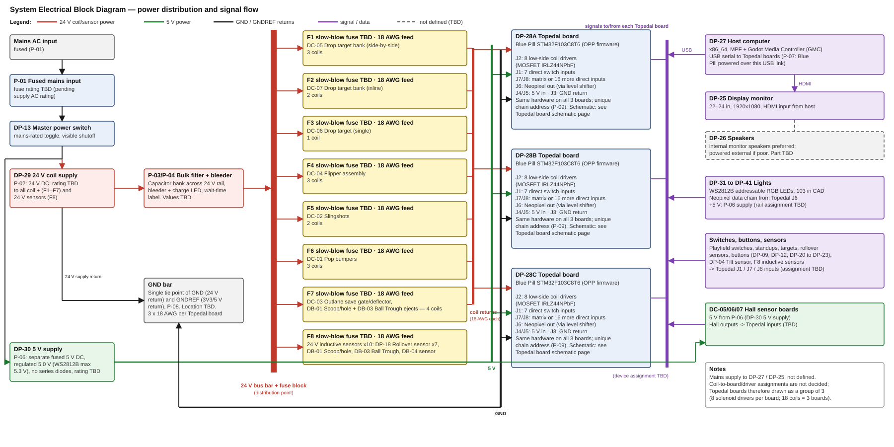

# Electrical Master

**Revision:** 20261110-03 · **Date:** 2026-11-10

## Block diagram

## Schematic

System-level schematic: not yet created. It includes the pin assignments and is blocked until the device-to-driver and device-to-input assignments are decided.
