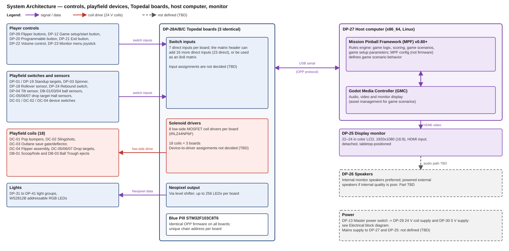

# Machine Master

**Revision:** 20261110-02 · **Date:** 2026-11-10

## System overview

### System

| Topic | Definition |
|---|---|
| Hybrid pinball | Typical pinball playing field used to accomplish game scenario objectives displayed real-time on monitor |
| Physical machine | Portable, tabletop cabinet containing typical pinball devices controlled using modern day electronics + monitor for real-time graphics |
| Game scenarios | Software defined theme packs played on generic playing field |

### Mechanical

| # | Item | Description |
|---|---|---|
| 1 | Cabinet | Baltic birch plywood construction |
| 2 | Materials | COTS materials and fasteners; 3D printed and laser cut custom parts |
| 3 | Access | Hinged playfield (service access); fixed bottom shelf panel; no legs — rubber pads only |

### Electrical

| # | Item | Description |
|---|---|---|
| 1 | Time-critical devices | All solenoid firing runs through the Topedal board's Blue Pill firmware (fire pulse, then PWM hold where used); no hardware autofire (safety). The switches for DC-01 Pop bumpers, DC-02 Slingshots and DC-04 Flipper Assembly are on the same Topedal board as their coils |
| 2 | Non-time-critical devices | Digital switches connected via Topedal board's onboard direct/matrix switch inputs |
| 3 | Rules engine & asset management | Computer supporting MPF + Godot Media Controller (GMC) running Mission Pinball Framework (MPF) — game logic, scoring, game scenarios; GMC for audio/video/monitor display |
| 4 | Comm bus | USB serial between host and Topedal board(s) |

### Software

| # | Item | Description |
|---|---|---|
| 1 | Firmware | Identical OPP firmware flashed to all Topedal boards (same STM32F103 processor as standard OPP), distinguished by board address; MPF config (not firmware) defines game scenario behavior |
| 2 | Game scenarios | A game scenario is defined by populating a Game Scenario Framework — requires no firmware changes |
| 3 | Playing field devices | <b>Primitive</b> — single physical switch/coil/sensor, no sub-components, assigned unique ID. <b>Composite</b> — 2 or more primitives combined to perform one coordinated physical action, e.g., button + coil + EOS sensor = flipper assembly. <b>Ball-state Device</b> — tracks ongoing ball location/count/presence as persistent state, e.g., scoop, ball lock, or trough |
| 4 | Game setup | Players select game preferences before starting a game. Setup parameters include standard parameters applicable to all scenarios + scenario-specific parameters |

## Requirements

### System-Level Requirements

| ID | Title | Definition | Category | Type |
|---|---|---|---|---|
| S-01 | Game play | Playing field ball action and control will be similar to a traditional, full sized pinball machine (1 1/16" dia balls, 40" x 20.5" playing field, 6.5-7 deg slope). Audio, graphics, and video are used to enhance the gaming experience including real-time game scenario progress | Functional | Mandatory |
| S-02 | Game scenarios | System supports user selectable game scenarios. Scenarios have unique themes that use the same generic playing field | Functional | Mandatory |
| S-03 | Game setup parameters | Game parameters will be selected by the player before each game is started. Example parameters include: game difficulty level, number of players, player names, scenario, scenario specific parameters | Functional | Mandatory |
| G-01 | Initialize game | Master power ON, monitor presents setup prompts which player selects | Functional | Mandatory |
| G-02 | Select scoring targets | Player uses onscreen game info to identify best scoring targets | Functional | Mandatory |
| G-03 | Shoot ball | Player launches ball onto playing field using shooter | Functional | Mandatory |
| G-04 | Playing field action | Player uses flippers and programmable buttons (DP-20 Programmable button) to keep ball in play and interact with the game to maximize score | Functional | Mandatory |
| G-05 | Repeat | Repeat steps G-02–G-04 until turn is over | Functional | Mandatory |
| C-01 | Physical | Portable system, played on tabletop, stored in typical household closet | Constraint | Mandatory |
| C-02 | Components | Use COTS parts and materials including modern electronics to replace traditional electro-mechanical, analog devices. Fab and assembly using standard workshop equipment plus 3D printer and 40W laser (24"x12" bed) | Constraint | Mandatory |
| C-03 | Safety | Electrical design will comply with industry-standard safety practices | Constraint | Mandatory |

### Software Requirements — Game Setup Parameters

| ID | Parameter | Scope | Setting | Default | Applies To | Comments |
|---|---|---|---|---|---|---|
| GP-01 | Number of players | Global | 1–4 | 1 | All | — |
| GP-02 | Player name/initials | Per-player | Free text | — | All | Data structure defined in Detailed Design |
| GP-03 | Per-player difficulty tier | Per-player | 1-Clueless 2-Beginner 3-Intermediate 4-Advanced 5-Champion | 3 | All | Data structure defined in Detailed Design |
| GP-04 | Balls per game | Global | 1–10 | 3 | All | — |
| GP-05 | Outlane save budget | Global | 0–5 | 3 | All | — |
| GP-06 | Outlane save time | Global | 0–15 seconds | 5 | All | — |
| GP-07 | Tilt warning count | Global | 0–5 | 3 | All | 0=Disabled |
| GP-08 | Tilt warning sensitivity | Global | 1-Very low 2-Low 3-Medium 4-High 5-Very high | 3 | All | Requires ADC test values |
| GP-09 | Game scenario selection | Global | List of installed scenario IDs | — | All | — |
| GP-10 | Outlane width | TBD | 1-Liberal 2-Normal 3-Difficult | 2 | All | Physical implementation: MD-02 Adjustable outlane pin. Scope TBD pending mechanism decision |

## System architecture

## Device Register

| ID | Device | Tier | Qty | Electrical? |
|---|---|---|---|---|
| DB-01 | Scoop/hole | Ball-State Device | 1 | Y |
| DB-02 | Ball lock | Ball-State Device | 0–1 (desired) | TBD |
| DB-03 | Ball Trough | Ball-State Device | 1 | Y |
| DB-04 | Shooter lane ball-present sensor | Ball-State Device | 1 | Y |
| DC-01 | Pop bumpers | Composite Mech | 3 | Y |
| DC-01A |  |  |  |  |
| DC-01B |  |  |  |  |
| DC-01C |  |  |  |  |
| DC-02 | Slingshots | Composite Mech | 2 | Y |
| DC-02A |  |  |  |  |
| DC-02A-sw1 |  |  |  |  |
| DC-02A-sw2 |  |  |  |  |
| DC-02B |  |  |  |  |
| DC-02B-sw1 |  |  |  |  |
| DC-02B-sw2 |  |  |  |  |
| DC-03 | Outlane save gate/deflector | Composite Mech | 2 | Y |
| DC-03A |  |  |  |  |
| DC-03B |  |  |  |  |
| DC-04 | Flipper assembly | Composite Mech | 3 | Y |
| DC-04A |  |  |  |  |
| DC-04B |  |  |  |  |
| DC-04C |  |  |  |  |
| DC-05 | Drop target bank (side-by-side) | Composite Mech | 7 | Y |
| DC-05A |  |  |  |  |
| DC-05B |  |  |  |  |
| DC-05C |  |  |  |  |
| DC-05D |  |  |  |  |
| DC-05E |  |  |  |  |
| DC-05F |  |  |  |  |
| DC-05G |  |  |  |  |
| DC-06 | Drop target (single) | Composite Mech | 1 | Y |
| DC-07 | Drop target bank (inline) | Composite Mech | 4 | Y |
| DC-07A |  |  |  |  |
| DC-07B |  |  |  |  |
| DC-07C |  |  |  |  |
| DC-07D |  |  |  |  |
| DP-01 | Standup targets (side-by-side) | Primitive | 6 | Y |
| DP-01A |  |  |  |  |
| DP-01B |  |  |  |  |
| DP-01C |  |  |  |  |
| DP-01D |  |  |  |  |
| DP-01E |  |  |  |  |
| DP-01F |  |  |  |  |
| DP-03 | Spinner | Primitive | 1 | Y |
| DP-04 | Tilt sensor | Primitive | 1 | Y |
| DP-09 | Flipper buttons | Primitive | 2 | Y |
| DP-09L |  |  |  |  |
| DP-09R |  |  |  |  |
| DP-12 | Game setup/start button | Primitive | 1 | Y |
| DP-13 | Master power switch | Primitive | 1 | Y |
| DP-18 | Rollover sensor | Primitive | 7 | Y |
| DP-18A |  |  |  |  |
| DP-18B |  |  |  |  |
| DP-18C |  |  |  |  |
| DP-18D |  |  |  |  |
| DP-18E |  |  |  |  |
| DP-18F |  |  |  |  |
| DP-18G |  |  |  |  |
| DP-19 | Standup target (single) | Primitive | 1 | Y |
| DP-20 | Programmable button | Primitive | 2 | Y |
| DP-20L |  |  |  |  |
| DP-20R |  |  |  |  |
| DP-21 | Exit button | Primitive | 1 | Y |
| DP-22 | Volume control | Primitive | 1 | Y |
| DP-23 | Monitor menu joystick | Primitive | 1 | Y |
| DP-24 | Rebound switch (leaf behind rubber ring) | Primitive | 2 | Y |
| DP-24A |  |  |  |  |
| DP-24B |  |  |  |  |
| DP-25 | Display monitor | System | 1 | Y |
| DP-26 | Speakers | System | 2 | Y |
| DP-26A |  |  |  |  |
| DP-26B |  |  |  |  |
| DP-27 | Host computer | System | 1 | Y |
| DP-28 | Topedal board | System | 3 | Y |
| DP-28A |  |  |  |  |
| DP-28B |  |  |  |  |
| DP-28C |  |  |  |  |
| DP-29 | 24 V coil supply | System | 1 | Y |
| DP-30 | 5 V supply | System | 1 | Y |
| DP-31 | Bonus rack lights | Primitive | 15 | Y |
| DP-31-01 |  |  |  |  |
| DP-31-02 |  |  |  |  |
| DP-31-03 |  |  |  |  |
| DP-31-04 |  |  |  |  |
| DP-31-05 |  |  |  |  |
| DP-31-06 |  |  |  |  |
| DP-31-07 |  |  |  |  |
| DP-31-08 |  |  |  |  |
| DP-31-09 |  |  |  |  |
| DP-31-10 |  |  |  |  |
| DP-31-11 |  |  |  |  |
| DP-31-12 |  |  |  |  |
| DP-31-13 |  |  |  |  |
| DP-31-14 |  |  |  |  |
| DP-31-15 |  |  |  |  |
| DP-32 | Drop-target ball lamps | Primitive | 14 | Y |
| DP-32-01 |  |  |  |  |
| DP-32-02 |  |  |  |  |
| DP-32-03 |  |  |  |  |
| DP-32-04 |  |  |  |  |
| DP-32-05 |  |  |  |  |
| DP-32-06 |  |  |  |  |
| DP-32-07 |  |  |  |  |
| DP-32-08 |  |  |  |  |
| DP-32-09 |  |  |  |  |
| DP-32-10 |  |  |  |  |
| DP-32-11 |  |  |  |  |
| DP-32-12 |  |  |  |  |
| DP-32-13 |  |  |  |  |
| DP-32-14 |  |  |  |  |
| DP-33 | DELUXE letter lights | Primitive | 6 | Y |
| DP-33-01 |  |  |  |  |
| DP-33-02 |  |  |  |  |
| DP-33-03 |  |  |  |  |
| DP-33-04 |  |  |  |  |
| DP-33-05 |  |  |  |  |
| DP-33-06 |  |  |  |  |
| DP-34 | ABCD lane feature lights | Primitive | 7 | Y |
| DP-34-01 |  |  |  |  |
| DP-34-02 |  |  |  |  |
| DP-34-03 |  |  |  |  |
| DP-34-04 |  |  |  |  |
| DP-34-05 |  |  |  |  |
| DP-34-06 |  |  |  |  |
| DP-34-07 |  |  |  |  |
| DP-35 | Left-lane feature lights | Primitive | 7 | Y |
| DP-35-01 |  |  |  |  |
| DP-35-02 |  |  |  |  |
| DP-35-03 |  |  |  |  |
| DP-35-04 |  |  |  |  |
| DP-35-05 |  |  |  |  |
| DP-35-06 |  |  |  |  |
| DP-35-07 |  |  |  |  |
| DP-36 | Bank shot value lights | Primitive | 2 | Y |
| DP-36-01 |  |  |  |  |
| DP-36-02 |  |  |  |  |
| DP-37 | DELUXE value lights | Primitive | 2 | Y |
| DP-37-01 |  |  |  |  |
| DP-37-02 |  |  |  |  |
| DP-38 | 8-ball saucer chain and outlane special lights | Primitive | 7 | Y |
| DP-38-01 |  |  |  |  |
| DP-38-02 |  |  |  |  |
| DP-38-03 |  |  |  |  |
| DP-38-04 |  |  |  |  |
| DP-38-05 |  |  |  |  |
| DP-38-06 |  |  |  |  |
| DP-38-07 |  |  |  |  |
| DP-39 | Bonus, multiplier and shoot-again lights | Primitive | 8 | Y |
| DP-39-01 |  |  |  |  |
| DP-39-02 |  |  |  |  |
| DP-39-03 |  |  |  |  |
| DP-39-04 |  |  |  |  |
| DP-39-05 |  |  |  |  |
| DP-39-06 |  |  |  |  |
| DP-39-07 |  |  |  |  |
| DP-39-08 |  |  |  |  |
| DP-40 | Pop bumper lights | Primitive | 3 | Y |
| DP-40-01 |  |  |  |  |
| DP-40-02 |  |  |  |  |
| DP-40-03 |  |  |  |  |
| DP-41 | General illumination lights | Primitive | 32 | Y |
| DP-41-01 |  |  |  |  |
| DP-41-02 |  |  |  |  |
| DP-41-03 |  |  |  |  |
| DP-41-04 |  |  |  |  |
| DP-41-05 |  |  |  |  |
| DP-41-06 |  |  |  |  |
| DP-41-07 |  |  |  |  |
| DP-41-08 |  |  |  |  |
| DP-41-09 |  |  |  |  |
| DP-41-10 |  |  |  |  |
| DP-41-11 |  |  |  |  |
| DP-41-12 |  |  |  |  |
| DP-41-13 |  |  |  |  |
| DP-41-14 |  |  |  |  |
| DP-41-15 |  |  |  |  |
| DP-41-16 |  |  |  |  |
| DP-41-17 |  |  |  |  |
| DP-41-18 |  |  |  |  |
| DP-41-19 |  |  |  |  |
| DP-41-20 |  |  |  |  |
| DP-41-21 |  |  |  |  |
| DP-41-22 |  |  |  |  |
| DP-41-23 |  |  |  |  |
| DP-41-24 |  |  |  |  |
| DP-41-25 |  |  |  |  |
| DP-41-26 |  |  |  |  |
| DP-41-27 |  |  |  |  |
| DP-41-28 |  |  |  |  |
| DP-41-29 |  |  |  |  |
| DP-41-30 |  |  |  |  |
| DP-41-31 |  |  |  |  |
| DP-41-32 |  |  |  |  |
| MC-01 | Cabinet body | Mechanical | Per CAD | N |
| MC-02 | Hinged playfield support | Mechanical | Per CAD | N |
| MC-03 | Glass top and slide retention | Mechanical | Per CAD | N |
| MC-04 | Bottom shelf | Mechanical | Per CAD | N |
| MC-05 | Rubber feet | Mechanical | Per CAD | N |
| MD-01 | Playfield post | Mechanical | Per CAD (not tracked) | N |
| MD-02 | Adjustable outlane pin | Mechanical | 2 | N |
| MD-02A |  |  |  |  |
| MD-02B |  |  |  |  |
| MG-01 | Ball guides | Mechanical | Per CAD (not tracked) | N |
| MG-02 | Apron | Mechanical | 1 | N |
| ML-01 | Shooter plunger + spring | Mechanical | 1 | N |
