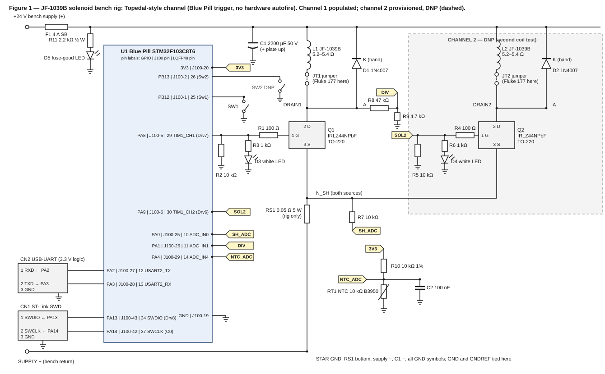

# Test Card — Solenoid Fire Modes and Heating (JF-1039B Bench Rig)

## Header

| Field | Value |
|---|---|
| Test ID / name | Solenoid fire modes and heating |
| Device ID and name | DC-04 Flipper assembly; DC-05 Drop target bank (side-by-side); DC-06 Drop target (single); DC-07 Drop target bank (inline); DC-02 Slingshots; DC-01 Pop bumpers; DC-03 Outlane save gate/deflector; DB-01 Scoop/hole; DB-03 Ball trough |
| Date | 2026-11-11 |
| Tester | Scott |
| Status | Planned. Rig not built; firmware not written. No results recorded. |

## Test Setup

One rig and one device-selectable STM32 (Blue Pill) firmware test the JF-1039B at the fire parameters of each device. All solenoid firing runs through the Blue Pill firmware (no hardware autofire), the same as the final machine. The coil is the same JF-1039B for every mode, so the thermal characterization (T3) runs once and each mode maps its average power onto it.

### Fire categories and modes

| Category | Mode | Devices | Fire | Hold | Inputs not yet defined in the device docs |
|---|---|---|---|---|---|
| A: pulse + PWM hold | A1 | DC-04 Flipper assembly | Full power to end of stroke, 24 V | PWM hold while the button is held; ends on release | Fire pulse width, hold duty, PWM frequency, max-on timer, refire limit (this card sets them) |
| A: pulse + PWM hold | A2 | DC-05 Drop target bank (side-by-side); DC-06 Drop target (single); DC-07 Drop target bank (inline) | Full power to end of stroke (plunger fully retracted), 24 V | PWM hold for a 25–30 ms dwell, then release; hold duty bench-tuned | Hold duty, reset rate |
| B: pulse only | B | DC-02 Slingshots; DC-01 Pop bumpers; DC-03 Outlane save gate/deflector; DB-01 Scoop/hole; DB-03 Ball trough | One firmware pulse per trigger, 24 V (DB-01 and DB-03: full-power eject) | None | Pulse width and maximum rate per device |

Coil per device: JF-1039B for DC-04, DC-05, DC-06, DC-07, DC-02, DB-01, DB-03. DC-01 and DC-03: coil part TBD, so their rows run only if the part is a JF-1039B or the rig coil is changed. DB-02 Ball lock: design TBD, excluded.

### Rig summary

| Item | Value |
|---|---|
| Build | Standalone breadboard (same design as a perf board) |
| Supply | Owned regulated bench supply, 30 V / 5 A maximum. Run at 12 V first, then 24 V; current limit about 3 A at 12 V and about 5 A at 24 V; 1.5 A for T3. Channel 2 stays DNP and F1 stays 4 A slow-blow |
| Power path | +24 V, coil, drain, source and ground runs are 18 AWG wire or perf-board traces sized for 4.5 A per channel (Scott); solderless breadboard carries signals only |
| Controller | Blue Pill STM32F103C8T6 (USB-C board), powered from USB |
| Toolchain | PlatformIO on the MacBook Air |
| Trigger path | Blue Pill firmware drives the MOSFET gate (fire pulse, then PWM hold in category A; fire pulse only in category B). Hold PWM on TIM1_CH1 (PA8): 5 kHz primary, 2 kHz secondary, 20 kHz optional with a Q1 heat sink |
| Channel assignment | Channel 1 = Topedal Drv7 (PA8, J100 pin 5, J2-8) with Sw1 (PB12). Channel 2 = Topedal Drv6 (PA9, J100 pin 6, J2-7) with Sw2 (PB13), DNP |
| Solenoid | JF-1039B, 5.2–5.4 Ω bench resistance; plunger return spring and C-clip removed (default drop-target configuration; configuration per run to be recorded) |
| Temperature | NTC bead RT1 (10 kΩ, B3950, MF52B style) taped to the coil winding; logging only (no thermal cutoff) |
| Current | RS1 shunt to PA0 (logged); Fluke 177 in series with the coil at JT1 (DC average) |
| Voltage | Drain divider R8/R9 to PA1 (logged) |
| Logging | USART2 (PA2/PA3) to USB-UART adapter CN2, MacBook Air terminal; SWD via ST-Link CN1 (PA13/PA14) for programming |
| Meter limits | Fluke 177 DC amps: 60 mA / 400 mA / 6 A / 10 A ranges; accuracy 1.0% + 3 counts; burden 37 mV/A on the 10 A input; 4 updates/s. It reads the average only and cannot capture the 50 ms fire peak |

### Schematic

[Figure 1 (standalone SVG)](solenoid_heating_rig_schematic.svg)

**Net table**

| Net | Connections |
|---|---|
| VIN | Bench supply +, F1 input |
| +24V | F1 output, C1 +, L1 top terminal, L2 top terminal (DNP), D1 cathode (band), D2 cathode (DNP), R11 |
| FUSE_LED | R11, D5 anode; D5 cathode to GND (lit while F1 is intact) |
| COIL_LO1 / COIL_LO2 | L1 / L2 bottom terminal, JT1 / JT2 terminal 1 |
| DRAIN1 / DRAIN2 | JT1 / JT2 terminal 2, Q1 / Q2 pin 2 (D), D1 / D2 anode, and R8 on DRAIN1 |
| SOL1 / SOL2 | U1 PA8 / PA9 (Topedal net sol1 / sol2), R1 / R4 (U1 side), R2 / R5 top, R3 / R6 top |
| GATE1 / GATE2 | R1 / R4 (Q side), Q1 / Q2 pin 1 (G) |
| LED1 / LED2 | R3 / R6 bottom, D3 / D4 anode; cathode to GND |
| N_SH | Q1 pin 3 (S), Q2 pin 3 (S, DNP), RS1 top, R7 |
| SH_ADC | R7, U1 PA0 |
| DIV | R8, R9 top, U1 PA1 |
| NTC_ADC | R10, RT1, C2, U1 PA4 |
| 3V3 | U1 3V3 pin, R10 |
| SW1_IN / SW2_IN | SW1 / SW2, U1 PB12 / PB13 (internal pull-up enabled in firmware; switch closes to GND) |
| UART | U1 PA2 → CN2-1; U1 PA3 ← CN2-2 |
| SWD | U1 PA13 → CN1-1; U1 PA14 → CN1-2 |
| GND / STAR GND | Supply −, RS1 bottom (single star point), C1 −, R2, R5, R9, D3, D4 returns, D5 cathode, RT1, C2, SW1, SW2, U1 GND, CN1-3, CN2-3. GND and GNDREF are one net on the rig; return wiring converges only at the RS1 bottom |

**Parts table and BOM** *(no prices; Scott handles procurement; Status: Required = needed for the channel-1 rig, Optional = convenience or spare, DNP = channel 2, populated for a second-coil test)*

| Ref | Part | Value | Qty | Status | Note |
|---|---|---|---|---|---|
| U1 | Blue Pill STM32F103C8T6, USB-C board | 3.3 V logic | 1 | Required | LQFP48 pin numbers shown on Figure 1 |
| Q1 | IRLZ44NPbF, TO-220 | 55 V | 1 | Required | Pins 1 G, 2 D, 3 S; RDS(on) max 0.035 Ω at 4 V (21 A), 0.025 Ω at 5 V, 0.022 Ω at 10 V; VGS(th) 1.0–2.0 V; Qg 48 nC, Qgd 25 nC; RθJA 62 °C/W. Not specified at a 3.3 V gate (T2 measures it). With RS1 in the source path, VGS is about 3.08 V at 4.5 A (3.3 V − 4.5 A × 0.05 Ω; calculated, ignores output sag) |
| L1 | JF-1039B solenoid | 5.2–5.4 Ω | 1 | Required | No manufacturer datasheet; reseller duty under 2 s per activation |
| D1 | 1N4007 | 1000 V, 1 A | 1 | Required | Flyback across L1, band = cathode. trr about 1.5 µs typ (Diotec) to 2 µs max (Vishay). UF4007 is the fallback if T1/T6 show a recovery problem |
| R1 | Resistor | 100 Ω | 1 | Required | Gate series, mirrors Topedal Rg. A 3.3 V step across 100 Ω is about 33 mA peak; the GPIO output impedance limits it to about 20 mA, under the 25 mA per-pin absolute maximum (STM32F103x8/xB Table 37 output levels) |
| R2 | Resistor | 10 kΩ | 1 | Required | Gate pulldown (Topedal Rp) |
| R3 | Resistor | 1 kΩ | 1 | Required | Gate LED series (Topedal Rd) |
| D3 | LED, 3 mm white | — | 1 | Required | Gate indicator (Topedal Dd) |
| SW1 | Pushbutton | — | 1 | Required | Fire/arm input, PB12 (Topedal Sw1) |
| F1 | Slow-blow fuse, Littelfuse 218 series (004.), 5×20 mm, with holder | 4 A | 1 | Required | Nominal melting I²t 69.1 A²s (test condition not stated); the datasheet gives no DC current rating; fire-pulse I²t at most 1.0 A²s (4.5² × 0.05); about 3.2 A RMS at a 100 ms refire interval (calculated). Does not protect the coil in a stuck-on fault. Channel 2 stays DNP, so F1 stays 4 A |
| C1 | Electrolytic | 2200 µF 50 V | 1 | Required | Supply decoupling only; the 4.5 A × 50 ms fire pulse comes from the bench supply (2200 µF alone would droop about 100 V over the pulse). Candidate: Rubycon YXJ 50YXJ2200M16X35.5 — 16 mm diameter, 7.5 mm lead spacing, 37.5 mm max seated height, ripple 3150 mA rms at 105 °C / 100 kHz (Rubycon sheet RYXJ-1039-1; DigiKey) |
| RS1 | Power resistor | 0.05 Ω 5 W | 1 | Required | Source shunt for current logging. 0.05 Ω instead of 0.1 Ω: 0.1 Ω drops 0.45 V at 4.5 A and cuts VGS from 3.3 V to about 2.85 V. Shunt resolution about 16 mA per count (calculated) |
| R7 | Resistor | 10 kΩ | 1 | Required | Shunt-sense series to PA0 |
| R8 / R9 | Resistors | 47 kΩ / 4.7 kΩ | 1 each | Required | Drain divider, about 11:1; PA1 source about 4.3 kΩ |
| RT1 | NTC bead MF52B | 10 kΩ, B3950 | 1 | Required | VANXY 20-pack (Amazon); logging sensor for T3, T4 and T6–T9, taped to the winding with thermal paste. Not a protection device |
| R10 | Resistor, 1% | 10 kΩ | 1 | Required | NTC pull-up to 3.3 V |
| C2 | Capacitor | 100 nF | 1 | Required | NTC ADC filter |
| — | 18 AWG wire, perf board | — | as needed | Required | All high-current paths |
| CN1 | ST-Link V2 | SWD | 1 | Required | Programming (PA13/PA14) |
| CN2 | USB-UART adapter | 3.3 V logic | 1 | Required | Logging (USART2 PA2/PA3) |
| — | Bench supply; Fluke 177 | — | — | Owned | Already owned |
| JT1 | 2-position screw terminal (Phoenix Contact MKDS 1,5/2-5,08 candidate) | — | 1 | Optional | 17.5 A nominal (IEC), UL 10 A, AWG 30–14. Jumper installed in normal running; Fluke 177 replaces it for averaged current. Scott has not selected a part |
| D5 | LED | — | 1 | Optional | Fuse-good indicator |
| R11 | Resistor | 2.2 kΩ ½ W | 1 | Optional | D5 series; ½ W rating |
| — | TO-220 insulating kit (pad and shoulder washer) | — | 1 | Optional | Q1 heat sink isolation (20 kHz option) |
| — | Spare 1N4007 and UF4007; heat sink for Q1 | — | 1 each | Optional | UF4007 fallback; heat sink for the 20 kHz option |
| — | Ice water, thermometer, thermal paste, Kapton tape | — | — | Optional | T4 calibration and NTC mounting |
| — | Oscilloscope | — | — | Optional | Not required |
| L2 | JF-1039B solenoid | 5.2–5.4 Ω | 1 | DNP | Second-coil test |
| Q2 | IRLZ44NPbF | — | 1 | DNP | |
| D2 | 1N4007 | — | 1 | DNP | |
| R4 / R5 / R6 | Resistors | 100 Ω / 10 kΩ / 1 kΩ | 1 each | DNP | Gate network, channel 2 |
| D4 | LED, 3 mm white | — | 1 | DNP | |
| SW2 | Pushbutton | — | 1 | DNP | PB13 (Topedal Sw2) |
| JT2 | 2-position screw terminal | — | 1 | DNP | Same as JT1 |

### Deviations from the final design

| Item | Rig | Final design (reference) | Reason |
|---|---|---|---|
| Hold PWM | Rig firmware, TIM1_CH1 on PA8 | OPP firmware; hold-PWM capability not verified | The rig sets the hold parameters; OPP behaviour on these pins is unverified |
| RS1 / R7 | 0.05 Ω shunt in the source path | None | Current logging |
| R8 / R9 | Drain divider to PA1 | None | Vds logging |
| RT1 / R10 / C2 | NTC to PA4 | None | Thermal logging only; no separate thermal control in the design |
| JT1 / JT2 | Screw terminal with jumper in the coil path | None | Fluke 177 average-current reading |
| F1 | 4 A on the +24 V rail | Flipper feed fuse, rating TBD | Bench protection |
| C1 | 2200 µF decoupling at the rig | Bulk filter, value TBD | Supply decoupling |
| D5 / R11 | Fuse-good LED | None | Indication; optional |
| CN1 / CN2 | PA13/PA14 for SWD, PA2/PA3 for USART2 | PA13 is Drv8, PA14 is C0, PA2/PA3 are C6/C7 (Topedal pin assignment) | Programming and logging; USART1 pins PA9/PA10 are Drv6/Drv5 and are not used |
| PA0, PA1, PA4 | Analog inputs for shunt, drain divider and NTC | C4, C5, R0 matrix pins (Topedal pin assignment) | Instrumentation; these pins are 3.3 V only |
| Grounds | GND and GNDREF are one net, tied at the RS1 bottom | Separate nets, tied at the GND bar | Single-supply rig |
| Load | Bench coil with plunger load per run | Device mechanism (flipper lever, drop-target lifter, kicker, eject) | Heating depends on the coil's electrical power; mechanical load per device is not on the rig |

Not deviations (mirror the final design): Blue Pill firmware trigger; IRLZ44NPbF low-side driver; gate network (GPIO net → 100 Ω → gate; 10 kΩ pulldown and 1 kΩ + white LED on the GPIO side); external flyback diode across the coil (the Topedal board has none); Drv7/PA8 and Drv6/PA9 with Sw1/PB12 and Sw2/PB13.

### Rig limits (starting values; firmware settings)

| Limit | Starting value | Basis |
|---|---|---|
| Supply current limit | 3 A at 12 V; 5 A at 24 V; 1.5 A for T3 | Scott; the 24 V fire peak is about 4.5 A (calculated), so the 5 A limit leaves about 8% margin |
| Duty clamp | Firmware cap on hold duty | Prevents commanding continuous full on |
| Max-on timer | Firmware cap on total on-time per run (max_on_s) | Stuck-on guard |
| Refire limit | Minimum interval between fire pulses | Mashing guard |
| Watchdog | IWDG enabled | Hang guard |
| Stuck-on detection | Firmware shuts off PWM if average current stays above the commanded hold level | Stuck-on guard; backed by IWDG and gate pulldown R2 |
| Shorted Q1 | Not covered by firmware; neither F1 nor the supply limit protects the winding (about 109 W; 4.5 A is 113% of 4 A and below the fuse's lowest opening-time row) | Left to the flipper feed fuse rating in the final design |
| NTC calibration | Two-point (T4) | Logging accuracy |
| Attendance | Operator at the bench with the supply output switch within reach for T2, T5, T6, T7 and T8 | Stuck-on guard (Scott concurred) |
| ADC sampling | 55.5 cycles on PA0, PA1 and PA4 | RAIN max 50 kΩ (STM32F103x8/xB Table 47, fADC 14 MHz); sources are R7 10 kΩ (PA0), 4.3 kΩ (PA1) and 5–10 kΩ with C2 (PA4) |

### Settings exposed over serial

fire_ms, hold_pct, freq (Hz), max_on_s, mode (A1, A2 or B), hold_ms (A2 dwell), rate (pulses per second, B and A2).

### Estimates used for planning (not measurements)

| Item | Value | Basis |
|---|---|---|
| Coil inductance, plunger seated | About 24 mH | Equal-τ scaling from the Stern 090-5041-OT measured pair |
| Coil inductance, plunger withdrawn | About 8 mH | Same |
| Hold duty giving about 0.75 A average | About 19% at 24 V (about 3.0 W) | Calculation from 5.3 Ω |
| Continuous dissipation allowance | About 4 W | Area scaling from Guardian T12x19 solenoid classes |
| Ripple heating at hold PWM | At or above 2–5 kHz about 1% or less; 20 kHz negligible; 500 Hz–1 kHz risky at low L | Calculation from the inductance estimate |
| Q1 switching loss | About 0.4–0.5 W at 5 kHz and about 1.4 W or more at 20 kHz (about +90 °C at RθJA 62 °C/W). The 5 kHz figure assumed a 220 Ω gate resistor and was not recomputed for the 100 Ω R1 | Order-of-magnitude estimate from datasheet Qg and Qgd (given at VGS 5 V, VDS 44 V), a 3.3 V gate and diode recovery; not a datasheet value |

### Datasheet-verified inputs

| Item | Result | Source |
|---|---|---|
| Blue Pill pin numbers | LQFP48: PA0 10, PA1 11, PA2 12, PA3 13, PA4 14, PA8 29 (TIM1_CH1), PA9 30 (TIM1_CH2), PA13 34, PA14 37, PB12 25, PB13 26 | STM32F103x8/xB datasheet Table 5 (DS5319 Rev 20) |
| I/O pin current | Absolute maximum 25 mA sunk or sourced per pin; gate current through R1 about 20 mA | STM32F103x8/xB datasheet Tables 7 and 37 |
| ADC source impedance | RAIN max 5.9 kΩ at 7.5 cycles, 11.4 kΩ at 13.5, 25.2 kΩ at 28.5, 50 kΩ at 55.5 (fADC 14 MHz, characterization only) | STM32F103x8/xB datasheet Table 47 |
| Q1 gate drive | RDS(on) not specified at 3.3 V; 3.0 V curves in Figs 1 and 3 not read | IRLZ44NPbF datasheet PD-94831 |
| D1 | 1N4007 trr about 1.5 µs typ (Diotec) to 2 µs max (Vishay). UF4007 (fallback) trr 75 ns max (IF 0.5 A, IR 1 A, Irr 0.25 A), VF 1.7 V max at 1 A, IFSM 30 A, DO-204AL, band = cathode; trr not specified at 0.75–4.5 A | Diotec and Vishay 1N4007 datasheets; Vishay UF4001–UF4007 datasheet |
| F1 | Littelfuse 218: 3.15 A I²t 38.15, 4 A 69.1, 5 A 111 A²s; opening time at least 60 min at 150%, 120 s max at 210%; no DC current rating given | Littelfuse 218 series datasheet |
| C1 candidate | Rubycon YXJ 50YXJ2200M16X35.5: ripple 3150 mA rms at 105 °C / 100 kHz; impedance 0.019 Ω at 20 °C; 10,000 h at 105 °C; 16 mm × 35.5 mm nominal | Rubycon sheet RYXJ-1039-1; DigiKey |
| JT1 | Phoenix MKDS 1,5/2-5,08: 17.5 A nominal, UL 10 A, AWG 30–14 | Phoenix Contact datasheet |

Not covered by any datasheet: RDS(on) at a 3.3 V gate; 1N4007 and UF4007 trr at 0.75–4.5 A; the 24/8 mH inductance baseline; the hold-duty and 4 W dissipation estimates; Topedal/OPP hold-PWM frequency capability and OPP behaviour on PA13/PA14/PA15/PB3/PB4.

## Test Results Table

Winding temperature limit: TBD (coil insulation class not documented for the JF-1039B). Rows that cite "limit TBD" cannot be marked PASS until the limit is set. Rows marked "Characterization" record values and have no pass/fail limit.

| Test Title / Description | Requirement | Result | Pass / Fail |
|---|---|---|---|
| T1 Inductance and τ (all modes). Step the coil at 6–12 V; log current rise through RS1; plunger seated, mid-stroke, withdrawn. Sets hold PWM frequency, D1 and Q1 margin, D1 selection (1N4007 versus UF4007) | Characterization: record L and τ = L/R at each plunger position (replaces the 24 mH / 8 mH estimates) | Not run | — |
| T2 Fire current at 24 V (all modes). Single fire pulse of fire_ms; 12 V check first; log peak current, current ramp, Vds with a 3.3 V gate, supply sag at the coil terminals. Sets fire pulse width, flipper feed fuse and supply trunk sizing | Record peak current and Vds at peak with a 3.3 V gate; Q1 suitability limit TBD (IRLZ44NPbF RDS(on) not specified at 3.3 V) | Not run | — |
| T3 Thermal resistance and time constant (all modes). Constant-power steps at 12 V, supply limit 1.5 A; winding temperature from resistance, ΔT = (R_hot/R_cold − 1)(234.5 + T_cold). Sets continuous hold power limit and stuck-on time-to-limit | Characterization: record R_cold, R_hot, steady-state ΔT per watt, time constant, NTC-versus-winding offset | Not run | — |
| T4 NTC two-point calibration. Ice water and a second known temperature, reading RT1 through the ADC | Characterization: record ADC counts at each point | Not run | — |
| T5 Minimum hold-in and drop-out current, mode A1 (DC-04 Flipper assembly). Fire, then step hold duty down until the plunger releases; step up until it holds under a tap; 12 V then 24 V. Sets hold duty and hold voltage | Record hold duty and current at release, and with margin under tap | Not run | — |
| T6 Continuous PWM-hold heating, mode A1. Fire, then hold at the T5 duty until temperature settles, at 5 kHz and 2 kHz (20 kHz optional with a Q1 heat sink); 12 V then 24 V. Sets hold duty and current, PWM frequency, max duty clamp, max-on timer | Steady winding temperature at or below the limit (TBD); record average current (Fluke and RS1), average Vdrain, time to steady state | Not run | — |
| T7 Repeated-fire (mashing) run, mode A1. Fire pulse of fire_ms at the shortest refire interval, then hold, repeated for a fixed count; 24 V. Sets refire interval limit and fire pulse width | Peak NTC temperature at or below the limit (TBD); no missed or late fire | Not run | — |
| T8 Timed-hold reset cycle, mode A2 (DC-05, DC-06, DC-07). Full-power fire, PWM hold for a 25–30 ms dwell, release; repeated at the drop-target reset rate (rate TBD) for a fixed count; 24 V. Sets hold duty and reset rate limit | Peak NTC temperature at or below the limit (TBD); plunger holds through the full dwell | Not run | — |
| T9 Pulse-only repeated run, mode B (DC-02 Slingshots, DC-01 Pop bumpers). Fire pulse of the device's width at its maximum rate until temperature settles; 24 V. Pulse width and rate TBD per device | Steady winding temperature at or below the limit (TBD); record pulse width, rate, average current | Not run | — |
| T10 Pulse-only bounding check, mode B (DC-03 Outlane save gate/deflector, DB-01 Scoop/hole, DB-03 Ball trough). Compare each device's average power (pulse width × maximum rate) with the T9 average power; run the device's own rate if higher | Device average power at or below the T9 tested average power, or its own run at or below the limit (TBD) | Not run | — |
